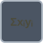

<!-- Generated by tools/export_studio_help.py; edit the reviewed source metadata, then regenerate. -->
# Multiply-Accumulate

[Numeric functions](index.md) · [All functions](../index.md)

Multiplies values and adds the product to an accumulator.

## Product execution profiles

The shared index declares native examples for this object; see [the examples below](multiply_accumulate.md#examples) and [document profiles and evidence boundaries](../../reference/studio-draft-examples.md). Older binding/help statements retained below can lag those product profiles. They do not establish or deny the separately measured native profiles. An example declaration alone is not an execution result or admission of every overload.

Résumé français de l’aide Studio

**Multiplier-accumuler**

Texte historique de l’aide conservé ci-dessous. Des exemples natifs distincts sont déclarés pour cet objet ; consultez les profils et preuves datés, sans déduire une compatibilité universelle de ce texte.

Multiplie des valeurs puis ajoute le produit a un accumulateur.

## Studio authoring profile

Contract status: **partial**. The connector below describes Studio authoring; execution availability is stated separately.

## IN — inputs

| Displayed terminal / internal ID | Accepted / resolved type | Studio connection | Unwired input default | Meaning |
| --- | --- | --- | --- | --- |
| x `x` | `T:numeric` | Optional | Not specified | — |
| y `y` | `T:numeric` | Optional | Not specified | — |
| initial value `initial_value` | `T:numeric` | Optional | Not specified | — |
| initialize? `initialize` | `bool` | Optional | Not specified | — |

A default is shown only for an input with an explicitly documented value. Preview/default *types* do not imply unwired operand values. If helper and binding flags differ, both are labelled.

## OUT — outputs

| Displayed terminal / internal ID | Accepted / resolved type | Studio connection | Unwired input default | Meaning |
| --- | --- | --- | --- | --- |
| accumulator + x * y `result` | `T:numeric` | Required | — | — |

A default is shown only for an input with an explicitly documented value. Preview/default *types* do not imply unwired operand values. If helper and binding flags differ, both are labelled.

## Types and Compatibility

The notes below retain the reviewed help's original NI and Studio scopes. An NI overload is not a claim of Studio runtime support; the authoring profile and execution limits remain separate.

Retained binding and help statements

These are source declarations, not the current measured product-execution assessment. Compare historical limitations with the separately dated native profiles above.

Numeric scalar x,y,initial value + Boolean initialize -&gt; numeric scalar accumulated result; not array lifting. Studio: Studio authoring supports the declared numeric scalar/array/cluster types; NI waveform, physical-unit and configurable fixed-point layout overloads are not modeled. Runtime execution still requires a target provider.

Point-by-point scalar real/integer multiply-accumulate. Each activation computes product=x*y in the common exact numeric type, then result=accumulator+product. First activation and initialize=True use initial_value before adding the product. Fresh execution frames reset the state; nodes and independent instances do not share it. Optional x/y/initial_value default to typed zero and initialize to False. No array lifting or complex/nominal/fixed-point erasure.

Notes de types et de compatibilité de l’aide Studio

Les mentions NI et Studio gardent leur portée d’origine. Une variante NI ne constitue pas une déclaration de prise en charge par le runtime Studio ; consultez les profils et limites d’exécution de cette fiche.

x,y,valeur initiale numériques scalaires + initialisation booléenne -&gt; accumulation scalaire ; pas d’extension aux tableaux. Studio: Profil de câblage uniquement : les variantes Waveform, unités physiques et formats de virgule fixe configurables ne sont pas modélisés. L’exécution nécessite toujours un fournisseur sur la cible.

- Type resolution: `custom_resolver`; result expression: `resolve:frog.studio.polymorphic.type-resolution@1`.
- Implicit coercion: not enabled by this resolver; individual port policies remain explicit.
- Arrays: not accepted; lifting policy: `none`.
- Shape rule: `per_port_contract`.
- Scalar lifting: no.

Scalar real/integer inputs only; no aggregate or scalar-to-array lifting.

**Input count:** 4; this contract does not enable variadic inputs.

## Execution and limits

**Public FROG / target Runtime:** not declared available by this authoring contract.

Scope: `requires_explicit_target_capability`.

Implementation: `frog.studio.numeric.multiply_accumulate.instance-owned.v1`.

Required provider: `frog.studio.numeric.multiply_accumulate.instance-owned@1`.

Declared instance-owned native capability, typed multiplication/addition from the existing numeric providers, transactional publication and resident state accounting. The selected target must admit the exact physical scalar signature. This declaration is not execution, AOT/package or NI runtime qualification.

Retained authoring-contract limitations

These declarations belong to the binding snapshot. Compare them with the separately admitted native profiles and dated measurements linked above; they are not a current denial of those product profiles.

**Authoring/target contract limits:**

- Requires the exact native target capability and supported common physical scalar type.
- No configurable fixed-point, complex, nominal Enum or aggregate overload. NI reset ordering is documented here as an explicit GS convention pending an independent NI execution comparison.

Connector type defaults and persistence aliases

| Direction | ID | Preview/default type | Connection policy | Cardinality | Legacy port IDs |
| --- | --- | --- | --- | --- | --- |
| INPUT | `x` | `f64` | `numeric_implicit` | `single` | — |
| INPUT | `y` | `f64` | `numeric_implicit` | `single` | — |
| INPUT | `initial_value` | `f64` | `numeric_implicit` | `single` | — |
| INPUT | `initialize` | `bool` | `any_explicit` | `single` | — |
| OUTPUT | `result` | `f64` | `any_explicit` | `single` | — |

## Examples

These are real `.frog` documents from the same index used by Studio. Backend names and expected results describe the examples; they are not execution certificates.

- [Multiply-Accumulate](../../examples/numeric.multiply_accumulate.worked.md) — Initialize the accumulator to 10 and add the product of 2 and 3. The indicator reads 16. (`execution`, `studio-draft`).

## Identity and references

- Catalogue ID: `numeric.multiply_accumulate`.
- Profile: `frog.studio.polymorphic.numeric.multiply_accumulate.v1`.
- Definition: `frog.studio.numeric.multiply_accumulate`.
- [NI API reference](https://www.ni.com/docs/en-US/bundle/labview-nxg-nodes-api-ref/page/multiply-accumulate-add.html).
- [NI API reference](https://www.ni.com/docs/en-US/bundle/daqexpress-api-ref/page/multiply-accumulate-add.html).

NI links are reference sources for the connector model; Studio support is limited to the profile above. [Reference provenance and notation](../index.md#provenance-and-notation).
