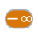

<!-- Generated by tools/export_studio_help.py; edit the reviewed source metadata, then regenerate. -->
# Negative Infinity

[Numeric functions](../index.md) · [All functions](../../index.md)

Places the negative infinity constant on the diagram.

Résumé français de l’aide Studio

**Moins l'infini**

Place la constante moins l'infini sur le diagramme. [Types] Aucune entrée ; sortie constante numérique réelle (DBL par défaut dans Studio).

## Studio authoring profile

Contract status: **partial**. The connector below describes Studio authoring; execution availability is stated separately.

Emits the fixed f64 value currently catalogued by Studio.

No input; one real numeric constant output (Studio default DBL).

## IN — inputs

No fixed inputs are declared in this binding profile. No connector is invented here.

## OUT — outputs

| Displayed terminal / internal ID | Accepted / resolved type | Studio connection | Unwired input default | Meaning |
| --- | --- | --- | --- | --- |
| -∞ `value` | `f64` | Required | — | — |

A default is shown only for an input with an explicitly documented value. Preview/default *types* do not imply unwired operand values. If helper and binding flags differ, both are labelled.

## Types and connection rules

fixed f64 output

- Type resolution: `fixed`; result expression: `f64`.
- Implicit coercion: not enabled by this resolver; individual port policies remain explicit.
- Arrays: not accepted; lifting policy: `none`.

none

**Input count:** 0; this contract does not enable variadic inputs.

no inputs

## Execution and limits

**Public FROG / target Runtime:** not declared available by this authoring contract.

Studio materializes the catalogued value, but no function provider or portable lowering contract is declared.

**Authoring/target contract limits:**

- No public FROG primitive identity or machine-readable function manifest exists.
- Portable Runtime lowering is not defined.

Connector type defaults and persistence aliases

| Direction | ID | Preview/default type | Connection policy | Cardinality | Legacy port IDs |
| --- | --- | --- | --- | --- | --- |
| OUTPUT | `value` | `f64` | `exact` | `single` | — |

## Identity and references

- Catalogue ID: `numeric.other_constants.negative_infinity`.
- Parent palette: [Other Constants](../other_constants.md).
- Profile: `numeric.fixed-f64-constant.partial`.
- Definition: `frog.studio.numeric.other_constants.negative_infinity`.
- [NI API reference](https://www.ni.com/docs/en-US/bundle/labview-nxg-nodes-api-ref/page/negative-infinity.html).

NI links are reference sources for the connector model; Studio support is limited to the profile above. [Reference provenance and notation](../../index.md#provenance-and-notation).
