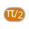

<!-- Generated by tools/export_studio_help.py; edit the reviewed source metadata, then regenerate. -->
# Pi / 2

[Numeric functions](../index.md) · [All functions](../../index.md)

Places one half of Pi on the diagram.

## Product execution profiles

The shared index declares native examples for this object; see [the examples below](pi_over_two.md#examples) and [document profiles and evidence boundaries](../../../reference/studio-draft-examples.md). Older binding/help statements retained below can lag those product profiles. They do not establish or deny the separately measured native profiles. An example declaration alone is not an execution result or admission of every overload.

Résumé français de l’aide Studio

**Pi / 2**

Texte historique de l’aide conservé ci-dessous. Des exemples natifs distincts sont déclarés pour cet objet ; consultez les profils et preuves datés, sans déduire une compatibilité universelle de ce texte.

Place la moitie de Pi sur le diagramme. [Types] Aucune entrée ; sortie constante numérique réelle (DBL par défaut dans Studio).

## Studio authoring profile

Contract status: **partial**. The connector below describes Studio authoring; execution availability is stated separately.

Retained binding and help description

This is the source declaration, not the current measured product-execution assessment.

Emits the fixed f64 value currently catalogued by Studio.

No input; one real numeric constant output (Studio default DBL).

## IN — inputs

No fixed inputs are declared in this binding profile. No connector is invented here.

## OUT — outputs

| Displayed terminal / internal ID | Accepted / resolved type | Studio connection | Unwired input default | Meaning |
| --- | --- | --- | --- | --- |
| π/2 `value` | `f64` | Required | — | — |

A default is shown only for an input with an explicitly documented value. Preview/default *types* do not imply unwired operand values. If helper and binding flags differ, both are labelled.

## Types and connection rules

fixed f64 output

- Type resolution: `fixed`; result expression: `f64`.
- Implicit coercion: not enabled by this resolver; individual port policies remain explicit.
- Arrays: not accepted; lifting policy: `none`.

none

**Input count:** 0; this contract does not enable variadic inputs.

no inputs

## Execution and limits

**Public FROG / target Runtime:** not declared available by this authoring contract.

Studio materializes the catalogued value, but no function provider or portable lowering contract is declared.

Retained authoring-contract limitations

These declarations belong to the binding snapshot. Compare them with the separately admitted native profiles and dated measurements linked above; they are not a current denial of those product profiles.

**Authoring/target contract limits:**

- No public FROG primitive identity or machine-readable function manifest exists.
- Portable Runtime lowering is not defined.

Connector type defaults and persistence aliases

| Direction | ID | Preview/default type | Connection policy | Cardinality | Legacy port IDs |
| --- | --- | --- | --- | --- | --- |
| OUTPUT | `value` | `f64` | `exact` | `single` | — |

## Examples

These are real `.frog` documents from the same index used by Studio. Backend names and expected results describe the examples; they are not execution certificates.

- [Pi / 2 — value and persistence](../../../examples/numeric.other_constants.pi_over_two.value_and_persistence.md) — Emits the fixed f64 value currently catalogued by Studio. (`execution`, `studio-draft`).

## Identity and references

- Catalogue ID: `numeric.other_constants.pi_over_two`.
- Parent palette: [Other Constants](../other_constants.md).
- Profile: `numeric.fixed-f64-constant.partial`.
- Definition: `frog.studio.numeric.other_constants.pi_over_two`.
- [NI API reference](https://www.ni.com/docs/en-US/bundle/labview-nxg-nodes-api-ref/page/pi-over-two.html).

NI links are reference sources for the connector model; Studio support is limited to the profile above. [Reference provenance and notation](../../index.md#provenance-and-notation).
