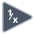

<!-- Generated by tools/export_studio_help.py; edit the reviewed source metadata, then regenerate. -->
# Reciprocal

[Numeric functions](index.md) · [All functions](../index.md)

Returns one divided by the input value.

## Product execution profiles

The shared index declares native examples for this object; see [the examples below](reciprocal.md#examples) and [document profiles and evidence boundaries](../../reference/studio-draft-examples.md). Older binding/help statements retained below can lag those product profiles. They do not establish or deny the separately measured native profiles. An example declaration alone is not an execution result or admission of every overload.

Résumé français de l’aide Studio

**Inverser**

Texte historique de l’aide conservé ci-dessous. Des exemples natifs distincts sont déclarés pour cet objet ; consultez les profils et preuves datés, sans déduire une compatibilité universelle de ce texte.

Renvoie un divise par la valeur d'entree. [Types] Scalaire numérique, tableau ou cluster récursivement numérique ; la sortie conserve la structure. Les feuilles entières donnent DBL. Studio: Ce profil d’édition ne modélise pas les largeurs de virgule fixe configurables de NI, les unités ni le remplacement par des VI propres aux matrices.

## Studio authoring profile

Contract status: **partial**. The connector below describes Studio authoring; execution availability is stated separately.

Retained binding and help description

This is the source declaration, not the current measured product-execution assessment.

Numeric scalar, array or recursively numeric cluster; result preserves aggregate structure. Integer leaves produce DBL.

Numeric scalar, array or recursively numeric cluster; result preserves aggregate structure. Integer leaves produce DBL. Studio: NI configurable fixed-point widths, units and matrix-specific VI replacement are not modeled by this authoring profile.

## IN — inputs

| Displayed terminal / internal ID | Accepted / resolved type | Studio connection | Unwired input default | Meaning |
| --- | --- | --- | --- | --- |
| x `in` | `T:numeric_tree` | Required | Not specified | — |

A default is shown only for an input with an explicitly documented value. Preview/default *types* do not imply unwired operand values. If helper and binding flags differ, both are labelled.

## OUT — outputs

| Displayed terminal / internal ID | Accepted / resolved type | Studio connection | Unwired input default | Meaning |
| --- | --- | --- | --- | --- |
| 1/x `result` | `T:any` | Recommended (help); Required (binding) | — | — |

A default is shown only for an input with an explicitly documented value. Preview/default *types* do not imply unwired operand values. If helper and binding flags differ, both are labelled.

## Types and connection rules

Numeric scalar, array or recursively numeric cluster; result preserves aggregate structure. Integer leaves produce DBL.

- Type resolution: `custom_resolver`; result expression: `resolve:frog.studio.polymorphic.type-resolution@1`.
- Implicit coercion: permitted by this profile.
- Arrays: accepted; lifting policy: `none`.

**Input count:** 1; this contract does not enable variadic inputs.

fixed unary

## Execution and limits

**Public FROG / target Runtime:** not declared available by this authoring contract.

No portable Runtime provider is declared.

Retained authoring-contract limitations

These declarations belong to the binding snapshot. Compare them with the separately admitted native profiles and dated measurements linked above; they are not a current denial of those product profiles.

**Authoring/target contract limits:**

- NI reference verified for authoring types; this does not establish runtime support on the active target.
- NI configurable fixed-point widths, units and matrix-specific VI replacement are not modeled by this authoring profile.

**Private Studio Run/Highlight:** the local function evaluator dispatches this catalogue identity. Inputs and output types must be resolved; unsupported value operations or representations fail explicitly. This local dispatch is separate from the public target Runtime declaration above.

Connector type defaults and persistence aliases

| Direction | ID | Preview/default type | Connection policy | Cardinality | Legacy port IDs |
| --- | --- | --- | --- | --- | --- |
| INPUT | `in` | `f64` | `any_explicit` | `single` | `a`, `value` |
| OUTPUT | `result` | `f64` | `exact` | `single` | — |

## Examples

These are real `.frog` documents from the same index used by Studio. Backend names and expected results describe the examples; they are not execution certificates.

- [Reciprocal — integer promotion i32](../../examples/numeric.reciprocal.integer_promotion_i32.md) — Numeric scalar, array or recursively numeric cluster; result preserves aggregate structure. (`execution`, `studio-draft`).
- [Reciprocal — integer promotion u32](../../examples/numeric.reciprocal.integer_promotion_u32.md) — Numeric scalar, array or recursively numeric cluster; result preserves aggregate structure. (`execution`, `studio-draft`).
- [Reciprocal — integer promotion i64](../../examples/numeric.reciprocal.integer_promotion_i64.md) — Numeric scalar, array or recursively numeric cluster; result preserves aggregate structure. (`execution`, `studio-draft`).
- [Reciprocal — integer promotion u64](../../examples/numeric.reciprocal.integer_promotion_u64.md) — Numeric scalar, array or recursively numeric cluster; result preserves aggregate structure. (`execution`, `studio-draft`).
- [Reciprocal — integer promotion f64](../../examples/numeric.reciprocal.integer_promotion_f64.md) — Numeric scalar, array or recursively numeric cluster; result preserves aggregate structure. (`execution`, `studio-draft`).

## Identity and references

- Catalogue ID: `numeric.reciprocal`.
- Profile: `frog.studio.polymorphic.numeric.reciprocal.v1`.
- Definition: `frog.math.reciprocal`.
- [NI API reference](https://www.ni.com/docs/en-US/bundle/labview-api-ref/page/functions/reciprocal.html).

NI links are reference sources for the connector model; Studio support is limited to the profile above. [Reference provenance and notation](../index.md#provenance-and-notation).
