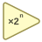

<!-- Generated by tools/export_studio_help.py; edit the reviewed source metadata, then regenerate. -->
# Scale By Power Of 2

[Numeric functions](index.md) · [All functions](../index.md)

Multiplies x by 2 raised to n.

## Product execution profiles

The shared index declares native examples for this object; see [the examples below](scale_power_two.md#examples) and [document profiles and evidence boundaries](../../reference/studio-draft-examples.md). Older binding/help statements retained below can lag those product profiles. They do not establish or deny the separately measured native profiles. An example declaration alone is not an execution result or admission of every overload.

Résumé français de l’aide Studio

**Multiplier par une puissance de 2**

Texte historique de l’aide conservé ci-dessous. Des exemples natifs distincts sont déclarés pour cet objet ; consultez les profils et preuves datés, sans déduire une compatibilité universelle de ce texte.

Multiplie x par 2 élevé à la puissance n.

## Studio authoring profile

Contract status: **partial**. The connector below describes Studio authoring; execution availability is stated separately.

## IN — inputs

| Displayed terminal / internal ID | Accepted / resolved type | Studio connection | Unwired input default | Meaning |
| --- | --- | --- | --- | --- |
| x `x` | `T:numeric_tree` | Required | Not specified | — |
| n `n` | `T:numeric_tree` | Required | Not specified | — |

A default is shown only for an input with an explicitly documented value. Preview/default *types* do not imply unwired operand values. If helper and binding flags differ, both are labelled.

## OUT — outputs

| Displayed terminal / internal ID | Accepted / resolved type | Studio connection | Unwired input default | Meaning |
| --- | --- | --- | --- | --- |
| x * 2^n `result` | `T:numeric_tree` | Recommended (help); Required (binding) | — | — |

A default is shown only for an input with an explicitly documented value. Preview/default *types* do not imply unwired operand values. If helper and binding flags differ, both are labelled.

## Types and Compatibility

The notes below retain the reviewed help's original NI and Studio scopes. An NI overload is not a claim of Studio runtime support; the authoring profile and execution limits remain separate.

Retained binding and help statements

These are source declarations, not the current measured product-execution assessment. Compare historical limitations with the separately dated native profiles above.

Numeric x and exponent n, scalar/aggregate -&gt; scaled numeric structure; exponent values converted to integer. The current native scalar provider preserves x in I4/U4/I8/U8/I16/U16/I32/U32/I64/U64/SGL/DBL and accepts the same plain integer/real types for n. Floating n rounds to the nearest integer with ties to even; it must be finite with rounded magnitude below 2^64. For real x, n must also fit signed32 and scaling follows IEEE ldexp behavior. For integer x, scaling uses width-bounded bit shifts; signed right shifts are arithmetic and unsigned right shifts zero-fill. Array/Cluster authoring still needs its own active target admission. Complex, configurable fixed-point, waveforms and physical units are not part of this plain scalar provider.

Scale x by 2 raised to rounded n, preserving the exact x representation. The owned scalar profile admits I4/U4/I8/U8/I16/U16/I32/U32/I64/U64/F32/F64 operands with result type equal to x; floating n rounds nearest ties-even and must have finite magnitude below 2^64. Real x uses ldexp with a checked signed-32 exponent. Integer x uses width-bounded shifts, arithmetic right shift for signed x and zero-fill right shift for unsigned x. Complete Array/Cluster authoring signatures still require separate target admission; no complex, configurable fixed-point, waveform or physical-unit scalar carrier is claimed.

Notes de types et de compatibilité de l’aide Studio

Les mentions NI et Studio gardent leur portée d’origine. Une variante NI ne constitue pas une déclaration de prise en charge par le runtime Studio ; consultez les profils et limites d’exécution de cette fiche.

x numérique et exposant n, scalaires/agrégats -&gt; structure numérique mise à l’échelle ; exposants convertis en entiers. Le fournisseur scalaire natif courant conserve x en I4/U4/I8/U8/I16/U16/I32/U32/I64/U64/SGL/DBL et accepte les mêmes types entiers/réels simples pour n. Si n est flottant, il est arrondi au plus proche, égalités vers le pair ; il doit être fini et sa magnitude arrondie inférieure à 2^64. Pour x réel, n doit aussi tenir dans un entier signé32 et le calcul suit le comportement IEEE de ldexp. Pour x entier, le calcul utilise des décalages bornés à sa largeur ; le décalage à droite signé est arithmétique et le non signé introduit des zéros. Les signatures auteur Tableau/Cluster nécessitent leur propre admission sur la cible active. Complexes, virgule fixe configurable, waveforms et unités physiques ne font pas partie de ce fournisseur scalaire simple.

Authoring preserves numeric representation of x and compatible shape; floating n is rounded ties-even. The compiled scalar profile requires exact F64 x,n,result.

- Type resolution: `custom_resolver`; result expression: `resolve:frog.studio.polymorphic.type-resolution@1`.
- Implicit coercion: not enabled by this resolver; individual port policies remain explicit.
- Arrays: accepted; lifting policy: `element_wise_same_shape_with_scalar_lift`.
- Shape rule: `compatible_rank_and_schema; scalar_lift`.
- Scalar lifting: yes.

**Input count:** 2; this contract does not enable variadic inputs.

## Execution and limits

**Public FROG / target Runtime:** not declared available by this authoring contract.

Scope: `requires_explicit_target_capability`.

Implementation: `frog.studio.numeric.scale_power_two.owned.v1`.

Required provider: `frog.studio.numeric.aggregate-left-fold@1`.

The existing compiled Numeric provider realizes a bounded exact-type profile on explicitly admitted targets. Required Source schemas, parameters, shapes and physical carriers remain checked; unsupported overloads are refused. Availability declaration is not a passing test or AOT/package qualification.

Retained authoring-contract limitations

These declarations belong to the binding snapshot. Compare them with the separately admitted native profiles and dated measurements linked above; they are not a current denial of those product profiles.

**Authoring/target contract limits:**

- Authoring Array/Cluster/integer signatures do not establish compiled target support; native v1 admits only exact F64 scalars.
- I64 exponent coercion, integer arithmetic-shift and configurable fixed-point/waveform overloads remain outside native v1.

**Private Studio Run/Highlight:** the local function evaluator dispatches this catalogue identity. Inputs and output types must be resolved; unsupported value operations or representations fail explicitly. This local dispatch is separate from the public target Runtime declaration above.

Connector type defaults and persistence aliases

| Direction | ID | Preview/default type | Connection policy | Cardinality | Legacy port IDs |
| --- | --- | --- | --- | --- | --- |
| INPUT | `x` | `f64` | `any_explicit` | `single` | — |
| INPUT | `n` | `f64` | `any_explicit` | `single` | — |
| OUTPUT | `result` | `f64` | `any_explicit` | `single` | — |

## Examples

These are real `.frog` documents from the same index used by Studio. Backend names and expected results describe the examples; they are not execution certificates.

- [Scale by a rounded power of two](../../examples/numeric.scale_power_two.half.md) — The exact scalar signature is x:F64,n:F64 -&gt; result:F64. With x=8, floating n rounds to the nearest even integer before scaling. The exponent's type remains F64; no implicit promotion or integer shift is claimed. (`execution`, `studio-draft`).
- [Scale by a rounded power of two](../../examples/numeric.scale_power_two.above-half.md) — The exact scalar signature is x:F64,n:F64 -&gt; result:F64. With x=8, floating n rounds to the nearest even integer before scaling. The exponent's type remains F64; no implicit promotion or integer shift is claimed. (`execution`, `studio-draft`).
- [Scale by a rounded power of two](../../examples/numeric.scale_power_two.one-half.md) — The exact scalar signature is x:F64,n:F64 -&gt; result:F64. With x=8, floating n rounds to the nearest even integer before scaling. The exponent's type remains F64; no implicit promotion or integer shift is claimed. (`execution`, `studio-draft`).
- [Scale by a rounded power of two](../../examples/numeric.scale_power_two.two-half.md) — The exact scalar signature is x:F64,n:F64 -&gt; result:F64. With x=8, floating n rounds to the nearest even integer before scaling. The exponent's type remains F64; no implicit promotion or integer shift is claimed. (`execution`, `studio-draft`).
- [Scale by a rounded power of two](../../examples/numeric.scale_power_two.negative-half.md) — The exact scalar signature is x:F64,n:F64 -&gt; result:F64. With x=8, floating n rounds to the nearest even integer before scaling. The exponent's type remains F64; no implicit promotion or integer shift is claimed. (`execution`, `studio-draft`).
- [Scale by a rounded power of two](../../examples/numeric.scale_power_two.below-negative-half.md) — The exact scalar signature is x:F64,n:F64 -&gt; result:F64. With x=8, floating n rounds to the nearest even integer before scaling. The exponent's type remains F64; no implicit promotion or integer shift is claimed. (`execution`, `studio-draft`).
- [Scale by a rounded power of two](../../examples/numeric.scale_power_two.negative-one-half.md) — The exact scalar signature is x:F64,n:F64 -&gt; result:F64. With x=8, floating n rounds to the nearest even integer before scaling. The exponent's type remains F64; no implicit promotion or integer shift is claimed. (`execution`, `studio-draft`).
- [Scale by a rounded power of two](../../examples/numeric.scale_power_two.negative-two-half.md) — The exact scalar signature is x:F64,n:F64 -&gt; result:F64. With x=8, floating n rounds to the nearest even integer before scaling. The exponent's type remains F64; no implicit promotion or integer shift is claimed. (`execution`, `studio-draft`).

## Identity and references

- Catalogue ID: `numeric.scale_power_two`.
- Profile: `frog.studio.polymorphic.numeric.scale_power_two.v1`.
- Definition: `frog.studio.numeric.scale_power_two`.
- [NI API reference](https://www.ni.com/docs/en-US/bundle/labview-nxg-nodes-api-ref/page/scale-by-power-of-2.html).
- [NI API reference](https://www.ni.com/docs/en-US/bundle/labview-api-ref/page/functions/scale-by-power-of-2.html).
- [NI API reference](https://www.ni.com/docs/en-US/bundle/labview-api-ref/page/functions/round-to-nearest.html).

NI links are reference sources for the connector model; Studio support is limited to the profile above. [Reference provenance and notation](../index.md#provenance-and-notation).
