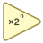

<!-- Generated by tools/export_studio_help.py; edit the reviewed source metadata, then regenerate. -->
# Scale By Power Of 2

[Numeric functions](index.md) · [All functions](../index.md)

Multiplies x by 2 raised to n.

## Product execution profiles

The shared index declares native examples for this object; see [the examples below](scale_power_two.md#examples) and [document profiles and evidence boundaries](../../reference/studio-draft-examples.md). Older binding/help statements retained below can lag those product profiles. They do not establish or deny the separately measured native profiles. An example declaration alone is not an execution result or admission of every overload.

Résumé français de l’aide Studio

**Multiplier par une puissance de 2**

Texte historique de l’aide conservé ci-dessous. Des exemples natifs distincts sont déclarés pour cet objet ; consultez les profils et preuves datés, sans déduire une compatibilité universelle de ce texte.

Multiplie x par 2 élevé à la puissance n. [Types] Le profil scalaire natif local est exactement x:F64,n:F64 -&gt; result:F64. L’exposant est arrondi à l’entier le plus proche, égalités vers le pair, et doit tenir dans un entier signé 32 bits. Le calcul préserve les résultats IEEE, dont les zéros signés et les débordements. Les autres signatures numériques et agrégées peuvent être câblées mais nécessitent leur propre réalisation cible ; aucune promotion implicite ni réalisation par décalage de bits entier n’est annoncée. Waveforms, unités physiques et formats de virgule fixe configurables ne sont pas modélisés.

## Studio authoring profile

Contract status: **partial**. The connector below describes Studio authoring; execution availability is stated separately.

Retained binding and help description

This is the source declaration, not the current measured product-execution assessment.

Scale x by 2 raised to rounded n; floating n uses nearest ties-even. The local compiled profile admits exact x:F64,n:F64-&gt;result:F64 only, with finite rounded n within signed32.

The local native scalar profile is exactly x:F64,n:F64 -&gt; result:F64. The exponent rounds to the nearest integer, with ties to even, and must fit a signed 32-bit integer. Scaling preserves IEEE results, including signed zero and overflow/underflow. Other numeric and aggregate signatures may be authored but need their own target implementation; no implicit promotion or integer bit-shift realization is claimed. Waveforms, physical units and configurable fixed-point layouts are not modeled.

## IN — inputs

| Displayed terminal / internal ID | Accepted / resolved type | Studio connection | Unwired input default | Meaning |
| --- | --- | --- | --- | --- |
| x `x` | `T:numeric_tree` | Required | Not specified | — |
| n `n` | `T:numeric_tree` | Required | Not specified | — |

A default is shown only for an input with an explicitly documented value. Preview/default *types* do not imply unwired operand values. If helper and binding flags differ, both are labelled.

## OUT — outputs

| Displayed terminal / internal ID | Accepted / resolved type | Studio connection | Unwired input default | Meaning |
| --- | --- | --- | --- | --- |
| x * 2^n `result` | `T:numeric_tree` | Recommended (help); Required (binding) | — | — |

A default is shown only for an input with an explicitly documented value. Preview/default *types* do not imply unwired operand values. If helper and binding flags differ, both are labelled.

## Types and connection rules

Authoring preserves numeric representation of x and compatible shape; floating n is rounded ties-even. The compiled scalar profile requires exact F64 x,n,result.

- Type resolution: `custom_resolver`; result expression: `resolve:frog.studio.polymorphic.type-resolution@1`.
- Implicit coercion: not enabled by this resolver; individual port policies remain explicit.
- Arrays: accepted; lifting policy: `element_wise_same_shape_with_scalar_lift`.
- Shape rule: `compatible_rank_and_schema; scalar_lift`.
- Scalar lifting: yes.

Numeric x and exponent n, scalar/aggregate -&gt; scaled numeric structure; exponent values converted to integer.

**Input count:** 2; this contract does not enable variadic inputs.

## Execution and limits

**Public FROG / target Runtime:** not declared available by this authoring contract.

Scope: `requires_explicit_target_capability`.

Implementation: `frog.studio.numeric.scale_power_two.real64.v1`.

Required provider: `frog.studio.numeric.scale-power-two-even@1; exact F64 ScalarProvider on active composed-native target`.

Exact local scalar x:F64,n:F64-&gt;result:F64. n rounds to nearest even independently of caller FENV, then must fit signed32. Nonfinite/out-of-domain n faults atomically. x signedzero, Inf and NaN bits preserved; finite ldexp follows native Runtime IEEE environment including under/overflow. No integer shift, aggregate or implicit numeric-promotion capability is implied.

Retained authoring-contract limitations

These declarations belong to the binding snapshot. Compare them with the separately admitted native profiles and dated measurements linked above; they are not a current denial of those product profiles.

**Authoring/target contract limits:**

- Authoring Array/Cluster/integer signatures do not establish compiled target support; native v1 admits only exact F64 scalars.
- I64 exponent coercion, integer arithmetic-shift and configurable fixed-point/waveform overloads remain outside native v1.

**Private Studio Run/Highlight:** the local function evaluator dispatches this catalogue identity. Inputs and output types must be resolved; unsupported value operations or representations fail explicitly. This local dispatch is separate from the public target Runtime declaration above.

Connector type defaults and persistence aliases

| Direction | ID | Preview/default type | Connection policy | Cardinality | Legacy port IDs |
| --- | --- | --- | --- | --- | --- |
| INPUT | `x` | `f64` | `any_explicit` | `single` | — |
| INPUT | `n` | `f64` | `any_explicit` | `single` | — |
| OUTPUT | `result` | `f64` | `any_explicit` | `single` | — |

## Examples

These are real `.frog` documents from the same index used by Studio. Backend names and expected results describe the examples; they are not execution certificates.

- [Scale by a rounded power of two](../../examples/numeric.scale_power_two.half.md) — The exact scalar signature is x:F64,n:F64 -&gt; result:F64. With x=8, floating n rounds to the nearest even integer before scaling. The exponent's type remains F64; no implicit promotion or integer shift is claimed. (`execution`, `studio-draft`).
- [Scale by a rounded power of two](../../examples/numeric.scale_power_two.above-half.md) — The exact scalar signature is x:F64,n:F64 -&gt; result:F64. With x=8, floating n rounds to the nearest even integer before scaling. The exponent's type remains F64; no implicit promotion or integer shift is claimed. (`execution`, `studio-draft`).
- [Scale by a rounded power of two](../../examples/numeric.scale_power_two.one-half.md) — The exact scalar signature is x:F64,n:F64 -&gt; result:F64. With x=8, floating n rounds to the nearest even integer before scaling. The exponent's type remains F64; no implicit promotion or integer shift is claimed. (`execution`, `studio-draft`).
- [Scale by a rounded power of two](../../examples/numeric.scale_power_two.two-half.md) — The exact scalar signature is x:F64,n:F64 -&gt; result:F64. With x=8, floating n rounds to the nearest even integer before scaling. The exponent's type remains F64; no implicit promotion or integer shift is claimed. (`execution`, `studio-draft`).
- [Scale by a rounded power of two](../../examples/numeric.scale_power_two.negative-half.md) — The exact scalar signature is x:F64,n:F64 -&gt; result:F64. With x=8, floating n rounds to the nearest even integer before scaling. The exponent's type remains F64; no implicit promotion or integer shift is claimed. (`execution`, `studio-draft`).
- [Scale by a rounded power of two](../../examples/numeric.scale_power_two.below-negative-half.md) — The exact scalar signature is x:F64,n:F64 -&gt; result:F64. With x=8, floating n rounds to the nearest even integer before scaling. The exponent's type remains F64; no implicit promotion or integer shift is claimed. (`execution`, `studio-draft`).
- [Scale by a rounded power of two](../../examples/numeric.scale_power_two.negative-one-half.md) — The exact scalar signature is x:F64,n:F64 -&gt; result:F64. With x=8, floating n rounds to the nearest even integer before scaling. The exponent's type remains F64; no implicit promotion or integer shift is claimed. (`execution`, `studio-draft`).
- [Scale by a rounded power of two](../../examples/numeric.scale_power_two.negative-two-half.md) — The exact scalar signature is x:F64,n:F64 -&gt; result:F64. With x=8, floating n rounds to the nearest even integer before scaling. The exponent's type remains F64; no implicit promotion or integer shift is claimed. (`execution`, `studio-draft`).

## Identity and references

- Catalogue ID: `numeric.scale_power_two`.
- Profile: `frog.studio.polymorphic.numeric.scale_power_two.v1`.
- Definition: `frog.studio.numeric.scale_power_two`.
- [NI API reference](https://www.ni.com/docs/en-US/bundle/labview-nxg-nodes-api-ref/page/scale-by-power-of-2.html).
- [NI API reference](https://www.ni.com/docs/en-US/bundle/labview-api-ref/page/functions/scale-by-power-of-2.html).
- [NI API reference](https://www.ni.com/docs/en-US/bundle/labview-api-ref/page/functions/round-to-nearest.html).

NI links are reference sources for the connector model; Studio support is limited to the profile above. [Reference provenance and notation](../index.md#provenance-and-notation).
