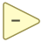

<!-- Generated by tools/export_studio_help.py; edit the reviewed source metadata, then regenerate. -->
# Subtract

[Numeric functions](index.md) · [All functions](../index.md)

Subtracts the second numeric input from the first.

## Product execution profiles

The shared index declares native examples for this object; see [the examples below](subtract.md#examples) and [document profiles and evidence boundaries](../../reference/studio-draft-examples.md). Older binding/help statements retained below can lag those product profiles. They do not establish or deny the separately measured native profiles. An example declaration alone is not an execution result or admission of every overload.

Résumé français de l’aide Studio

**Soustraire**

Texte historique de l’aide conservé ci-dessous. Des exemples natifs distincts sont déclarés pour cet objet ; consultez les profils et preuves datés, sans déduire une compatibilité universelle de ce texte.

Soustrait la seconde entree numerique de la premiere.

## Studio authoring profile

Contract status: **partial**. The connector below describes Studio authoring; execution availability is stated separately.

## IN — inputs

| Displayed terminal / internal ID | Accepted / resolved type | Studio connection | Unwired input default | Meaning |
| --- | --- | --- | --- | --- |
| x `a` | `T:numeric_convertible_tree` | Required | Not specified | — |
| y `b` | `T:numeric_convertible_tree` | Required | Not specified | — |

A default is shown only for an input with an explicitly documented value. Preview/default *types* do not imply unwired operand values. If helper and binding flags differ, both are labelled.

## OUT — outputs

| Displayed terminal / internal ID | Accepted / resolved type | Studio connection | Unwired input default | Meaning |
| --- | --- | --- | --- | --- |
| x - y `result` | `T:any` | Recommended (help); Required (binding) | — | — |

A default is shown only for an input with an explicitly documented value. Preview/default *types* do not imply unwired operand values. If helper and binding flags differ, both are labelled.

## Types and Compatibility

The notes below retain the reviewed help's original NI and Studio scopes. An NI overload is not a claim of Studio runtime support; the authoring profile and execution limits remain separate.

Retained binding and help statements

These are source declarations, not the current measured product-execution assessment. Compare historical limitations with the separately dated native profiles above.

Numeric scalars, arrays and numeric clusters operate element by element, with compatible shapes and numeric promotion. Timestamp minus timestamp yields DBL; timestamp minus a real duration yields timestamp. Studio: Studio does not implement NI waveform/dynamic-data node replacement, physical units or configurable fixed-point word lengths.

Notes de types et de compatibilité de l’aide Studio

Les mentions NI et Studio gardent leur portée d’origine. Une variante NI ne constitue pas une déclaration de prise en charge par le runtime Studio ; consultez les profils et limites d’exécution de cette fiche.

Scalaires numériques, tableaux et clusters numériques : opération élément par élément, formes compatibles et promotion numérique. Timestamp moins timestamp donne DBL ; timestamp moins durée réelle donne timestamp. Studio: Studio n’implémente pas le remplacement des nœuds NI de waveform ou de données dynamiques, les unités physiques ni les longueurs de mot configurables en virgule fixe.

- Type resolution: `custom_resolver`; result expression: `resolve:frog.studio.polymorphic.type-resolution@1`.
- Implicit coercion: permitted by this profile.
- Arrays: accepted; lifting policy: `none`.

**Input count:** 2; this contract does not enable variadic inputs.

fixed binary

## Execution and limits

**Public FROG / target Runtime:** not declared available by this authoring contract.

Scope: `requires_explicit_target_capability`.

Implementation: `frog.studio.numeric.subtract.owned.v1`.

Required provider: `frog.studio.numeric.aggregate-left-fold@1`.

The existing compiled Numeric provider realizes a bounded exact-type profile on explicitly admitted targets. Required Source schemas, parameters, shapes and physical carriers remain checked; unsupported overloads are refused. Availability declaration is not a passing test or AOT/package qualification.

Retained authoring-contract limitations

These declarations belong to the binding snapshot. Compare them with the separately admitted native profiles and dated measurements linked above; they are not a current denial of those product profiles.

**Authoring/target contract limits:**

- NI reference verified for authoring types; this does not establish runtime support on the active target.
- Studio does not implement NI waveform/dynamic-data node replacement, physical units or configurable fixed-point word lengths.

**Private Studio Run/Highlight:** the local function evaluator dispatches this catalogue identity. Inputs and output types must be resolved; unsupported value operations or representations fail explicitly. This local dispatch is separate from the public target Runtime declaration above.

Local arithmetic includes F32/F64 and supported integer leaves, scalar lifting and matching-shape Arrays. It preserves the resolved aggregate shape and narrows each step of the canonical arithmetic fold. Complex and extended-precision leaf arithmetic is not implemented by this evaluator. Array execution here does not establish a public target Array provider.

Connector type defaults and persistence aliases

| Direction | ID | Preview/default type | Connection policy | Cardinality | Legacy port IDs |
| --- | --- | --- | --- | --- | --- |
| INPUT | `a` | `f64` | `any_explicit` | `single` | — |
| INPUT | `b` | `f64` | `any_explicit` | `single` | — |
| OUTPUT | `result` | `f64` | `exact` | `single` | — |

## Examples

These are real `.frog` documents from the same index used by Studio. Backend names and expected results describe the examples; they are not execution certificates.

- [Subtract — scalar i32](../../examples/numeric.subtract.scalar_i32.md) — Numeric scalars, arrays and numeric clusters operate element by element, with compatible shapes and numeric promotion. (`execution`, `studio-draft`).
- [Subtract — scalar u32](../../examples/numeric.subtract.scalar_u32.md) — Numeric scalars, arrays and numeric clusters operate element by element, with compatible shapes and numeric promotion. (`execution`, `studio-draft`).
- [Subtract — scalar i64](../../examples/numeric.subtract.scalar_i64.md) — Numeric scalars, arrays and numeric clusters operate element by element, with compatible shapes and numeric promotion. (`execution`, `studio-draft`).
- [Subtract — scalar u64](../../examples/numeric.subtract.scalar_u64.md) — Numeric scalars, arrays and numeric clusters operate element by element, with compatible shapes and numeric promotion. (`execution`, `studio-draft`).
- [Subtract — scalar f64](../../examples/numeric.subtract.scalar_f64.md) — Numeric scalars, arrays and numeric clusters operate element by element, with compatible shapes and numeric promotion. (`execution`, `studio-draft`).

## Identity and references

- Catalogue ID: `numeric.subtract`.
- Profile: `frog.studio.polymorphic.numeric.subtract.v1`.
- Definition: `frog.core.sub`.
- [NI API reference](https://www.ni.com/docs/en-US/bundle/labview-api-ref/page/functions/subtract.html).

NI links are reference sources for the connector model; Studio support is limited to the profile above. [Reference provenance and notation](../index.md#provenance-and-notation).
