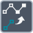

<!-- Generated by tools/export_studio_help.py; edit the reviewed source metadata, then regenerate. -->
# Compose Path

[Path functions](index.md) · [All functions](../index.md)

Builds a path from path components.

Résumé français de l’aide Studio

**Composer un chemin**

Construit un chemin a partir de ses composants. [Types] Un chemin de base scalaire (facultatif, vide par défaut) et un nom/chemin relatif scalaire de type Chemin ou Chaîne produisent un chemin scalaire. Pas de propagation sur les tableaux ou clusters.

## Studio authoring profile

Contract status: **partial**. The connector below describes Studio authoring; execution availability is stated separately.

A scalar base Path (optional, empty by default) and one scalar name/relative Path or String produce a scalar appended Path. No array or cluster lifting.

A scalar base Path (optional, empty by default) and one scalar name/relative Path or String produce a scalar appended Path. No array or cluster lifting.

## IN — inputs

| Displayed terminal / internal ID | Accepted / resolved type | Studio connection | Unwired input default | Meaning |
| --- | --- | --- | --- | --- |
| base path `base_path` | `path` | Recommended (help); Optional (binding) | Not specified | — |
| name or relative path `name_or_relative_path` | `T:any` | Required | Not specified | — |

A default is shown only for an input with an explicitly documented value. Preview/default *types* do not imply unwired operand values. If helper and binding flags differ, both are labelled.

## OUT — outputs

| Displayed terminal / internal ID | Accepted / resolved type | Studio connection | Unwired input default | Meaning |
| --- | --- | --- | --- | --- |
| result `result` | `path` | Recommended (help); Required (binding) | — | — |

A default is shown only for an input with an explicitly documented value. Preview/default *types* do not imply unwired operand values. If helper and binding flags differ, both are labelled.

## Types and connection rules

A scalar base Path (optional, empty by default) and one scalar name/relative Path or String produce a scalar appended Path. No array or cluster lifting.

- Type resolution: `custom_resolver`; result expression: `resolve:frog.studio.polymorphic.type-resolution@1`.
- Implicit coercion: not enabled by this resolver; individual port policies remain explicit.
- Arrays: not accepted; lifting policy: `none`.

**Input count:** 2; this contract does not enable variadic inputs.

## Execution and limits

**Public FROG / target Runtime:** not declared available by this authoring contract.

Scope: `requires_explicit_target_capability`.

Provider identity is retained from Studio. Executability must be established by the active target; it is not inferred from catalog visibility.

**Authoring/target contract limits:**

- NI reference verified for authoring types; this does not establish runtime support on the active target.

Connector type defaults and persistence aliases

| Direction | ID | Preview/default type | Connection policy | Cardinality | Legacy port IDs |
| --- | --- | --- | --- | --- | --- |
| INPUT | `base_path` | `path` | `any_explicit` | `single` | — |
| INPUT | `name_or_relative_path` | `path` | `any_explicit` | `single` | `name`, `relative_path` |
| OUTPUT | `result` | `path` | `any_explicit` | `single` | `appended_path` |

## Identity and references

- Catalogue ID: `path.compose`.
- Profile: `frog.studio.polymorphic.path.compose.v1`.
- Definition: `frog.studio.path.compose`.
- [NI API reference](https://www.ni.com/docs/en-US/bundle/labview-api-ref/page/functions/build-path.html).

NI links are reference sources for the connector model; Studio support is limited to the profile above. [Reference provenance and notation](../index.md#provenance-and-notation).
