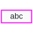

<!-- Generated by tools/export_studio_help.py; edit the reviewed source metadata, then regenerate. -->
# String Constant

[String functions](index.md) · [All functions](../index.md)

Places an editable string constant on the diagram.

## Product execution profiles

The shared index declares native examples for this object; see [the examples below](constant.md#examples) and [document profiles and evidence boundaries](../../reference/studio-draft-examples.md). Older binding/help statements retained below can lag those product profiles. They do not establish or deny the separately measured native profiles. An example declaration alone is not an execution result or admission of every overload.

Résumé français de l’aide Studio

**Constante chaine**

Texte historique de l’aide conservé ci-dessous. Des exemples natifs distincts sont déclarés pour cet objet ; consultez les profils et preuves datés, sans déduire une compatibilité universelle de ce texte.

Place une constante chaine editable sur le diagramme.

## Studio authoring profile

Contract status: **editor managed**. This is an editor-managed element; placement and configured values are distinct from an executable function provider.

## IN — inputs

No fixed inputs are declared in this binding profile. The editor or selected instance owns any contextual terminals.

## OUT — outputs

No fixed outputs are declared in this binding profile. The editor or selected instance owns any contextual terminals.

## Types and Compatibility

The notes below retain the reviewed help's original NI and Studio scopes. An NI overload is not a claim of Studio runtime support; the authoring profile and execution limits remain separate.

Retained binding and help statements

These are source declarations, not the current measured product-execution assessment. Compare historical limitations with the separately dated native profiles above.

Editable scalar String constant. The editor owns its value terminal and display modes; it does not acquire an array rank from wiring.

Notes de types et de compatibilité de l’aide Studio

Les mentions NI et Studio gardent leur portée d’origine. Une variante NI ne constitue pas une déclaration de prise en charge par le runtime Studio ; consultez les profils et limites d’exécution de cette fiche.

Constante chaîne scalaire éditable. L’éditeur gère sa borne de valeur et ses modes d’affichage ; le câblage ne lui donne pas de rang de tableau.

Historical Studio binding profile; no additional public FROG semantics are claimed.

- Type resolution: `fixed`; result expression: `editor_managed`.
- Implicit coercion: not enabled by this resolver; individual port policies remain explicit.
- Arrays: not established; lifting policy: `none`.

Only the declared port expressions and connection policies are defined by this Studio profile; general array semantics remain unspecified.

Input count is instance-dependent or not established by this contract.

## Execution and limits

**Public FROG / target Runtime:** not declared available by this authoring contract.

Scope: `requires_explicit_target_capability`.

Implementation: `frog.studio.editor-managed`.

Provider identity is retained from Studio. Executability must be established by the active target; it is not inferred from catalog visibility.

Retained authoring-contract limitations

These declarations belong to the binding snapshot. Compare them with the separately admitted native profiles and dated measurements linked above; they are not a current denial of those product profiles.

**Authoring/target contract limits:**

- The complete public execution semantics and target support for this legacy Studio profile have not been established.

Connector type defaults and persistence aliases

| Direction | ID | Preview/default type | Connection policy | Cardinality | Legacy port IDs |
| --- | --- | --- | --- | --- | --- |

## Examples

These are real `.frog` documents from the same index used by Studio. Backend names and expected results describe the examples; they are not execution certificates.

- [String Constant](../../examples/string.constant.worked.md) — Run displays the built-in value value = "Welcome". (`execution`, `studio-draft`).

## Identity and references

- Catalogue ID: `string.constant`.
- Profile: `frog.studio.legacy.string.constant.v1`.
- Definition: `frog.studio.string.constant`.
- [NI API reference](https://www.ni.com/docs/en-US/bundle/labview-api-ref/page/constants/string.html).

NI links are reference sources for the connector model; Studio support is limited to the profile above. [Reference provenance and notation](../index.md#provenance-and-notation).
