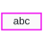

<!-- Generated by tools/export_studio_help.py; edit the reviewed source metadata, then regenerate. -->
# String Constant

[String functions](index.md) · [All functions](../index.md)

Places an editable string constant on the diagram.

Résumé français de l’aide Studio

**Constante chaine**

Place une constante chaine editable sur le diagramme. [Types] Constante chaîne scalaire éditable. L’éditeur gère sa borne de valeur et ses modes d’affichage ; le câblage ne lui donne pas de rang de tableau.

## Studio authoring profile

Contract status: **editor managed**. This is an editor-managed element; placement and configured values are distinct from an executable function provider.

Editable scalar String constant. The editor owns its value terminal and display modes; it does not acquire an array rank from wiring.

## IN — inputs

No fixed inputs are declared in this binding profile. The editor or selected instance owns any contextual terminals.

## OUT — outputs

No fixed outputs are declared in this binding profile. The editor or selected instance owns any contextual terminals.

## Types and connection rules

Historical Studio binding profile; no additional public FROG semantics are claimed.

- Type resolution: `fixed`; result expression: `editor_managed`.
- Implicit coercion: not enabled by this resolver; individual port policies remain explicit.
- Arrays: not established; lifting policy: `none`.

Only the declared port expressions and connection policies are defined by this Studio profile; general array semantics remain unspecified.

Input count is instance-dependent or not established by this contract.

## Execution and limits

**Public FROG / target Runtime:** not declared available by this authoring contract.

Scope: `requires_explicit_target_capability`.

Implementation: `frog.studio.editor-managed`.

Provider identity is retained from Studio. Executability must be established by the active target; it is not inferred from catalog visibility.

**Authoring/target contract limits:**

- The complete public execution semantics and target support for this legacy Studio profile have not been established.

Connector type defaults and persistence aliases

| Direction | ID | Preview/default type | Connection policy | Cardinality | Legacy port IDs |
| --- | --- | --- | --- | --- | --- |

## Identity and references

- Catalogue ID: `string.constant`.
- Profile: `frog.studio.legacy.string.constant.v1`.
- Definition: `frog.studio.string.constant`.
- [NI API reference](https://www.ni.com/docs/en-US/bundle/labview-api-ref/page/constants/string.html).

NI links are reference sources for the connector model; Studio support is limited to the profile above. [Reference provenance and notation](../index.md#provenance-and-notation).
