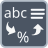

<!-- Generated by tools/export_studio_help.py; edit the reviewed source metadata, then regenerate. -->
# Format Value

[String functions](../index.md) · [All functions](../../index.md)

Formats a value according to a format specification.

Résumé français de l’aide Studio

**Formater une valeur**

Formate une valeur selon une specification de format. [Types] Une valeur numérique scalaire, un format et une chaîne initiale facultative produisent une chaîne. Tableaux, clusters et valeurs non numériques refusés.

## Studio authoring profile

Contract status: **partial**. The connector below describes Studio authoring; execution availability is stated separately.

One scalar numeric value, format String and optional initial String produce one String. Arrays, clusters and nonnumeric values are rejected.

One scalar numeric value, format String and optional initial String produce one String. Arrays, clusters and nonnumeric values are rejected.

## IN — inputs

| Displayed terminal / internal ID | Accepted / resolved type | Studio connection | Unwired input default | Meaning |
| --- | --- | --- | --- | --- |
| initial string `initial_string` | `string` | Recommended (help); Optional (binding) | Not specified | — |
| format string `format_string` | `string` | Recommended (help); Optional (binding) | Not specified | — |
| value `value` | `T:numeric` | Recommended (help); Optional (binding) | Not specified | — |

A default is shown only for an input with an explicitly documented value. Preview/default *types* do not imply unwired operand values. If helper and binding flags differ, both are labelled.

## OUT — outputs

| Displayed terminal / internal ID | Accepted / resolved type | Studio connection | Unwired input default | Meaning |
| --- | --- | --- | --- | --- |
| result `result` | `string` | Recommended (help); Required (binding) | — | — |

A default is shown only for an input with an explicitly documented value. Preview/default *types* do not imply unwired operand values. If helper and binding flags differ, both are labelled.

## Types and connection rules

One scalar numeric value, format String and optional initial String produce one String. Arrays, clusters and nonnumeric values are rejected.

- Type resolution: `custom_resolver`; result expression: `resolve:frog.studio.polymorphic.type-resolution@1`.
- Implicit coercion: not enabled by this resolver; individual port policies remain explicit.
- Arrays: not accepted; lifting policy: `none`.

**Input count:** 3; this contract does not enable variadic inputs.

## Execution and limits

**Public FROG / target Runtime:** not declared available by this authoring contract.

Scope: `requires_explicit_target_capability`.

Provider identity is retained from Studio. Executability must be established by the active target; it is not inferred from catalog visibility.

**Authoring/target contract limits:**

- NI reference verified for authoring types; this does not establish runtime support on the active target.

Connector type defaults and persistence aliases

| Direction | ID | Preview/default type | Connection policy | Cardinality | Legacy port IDs |
| --- | --- | --- | --- | --- | --- |
| INPUT | `initial_string` | `string` | `any_explicit` | `single` | `string` |
| INPUT | `format_string` | `string` | `any_explicit` | `single` | — |
| INPUT | `value` | `f64` | `numeric_implicit` | `single` | — |
| OUTPUT | `result` | `string` | `any_explicit` | `single` | `output_string` |

## Identity and references

- Catalogue ID: `string.conversion.format_value`.
- Parent palette: [Conversion](../conversion.md).
- Profile: `frog.studio.polymorphic.string.conversion.format_value.v1`.
- Definition: `frog.studio.string.conversion.format_value`.
- [NI API reference](https://www.ni.com/docs/en-US/bundle/labview-api-ref/page/functions/format-value.html).

NI links are reference sources for the connector model; Studio support is limited to the profile above. [Reference provenance and notation](../../index.md#provenance-and-notation).
