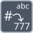

<!-- Generated by tools/export_studio_help.py; edit the reviewed source metadata, then regenerate. -->
# Number To Octal String

[String functions](../index.md) · [All functions](../../index.md)

Formats a number as an octal string.

Résumé français de l’aide Studio

**Nombre vers chaine octale**

Formate un nombre dans une chaine octale. [Types] Les numériques scalaires et tableaux/clusters numériques deviennent des chaînes (octal), avec rangs et schémas conservés. Largeur scalaire I32.

## Studio authoring profile

Contract status: **partial**. The connector below describes Studio authoring; execution availability is stated separately.

Numeric scalars and numeric-only arrays/clusters convert to octal String leaves, preserving ranks and cluster schemas. Width is scalar I32.

Numeric scalars and numeric-only arrays/clusters convert to octal String leaves, preserving ranks and cluster schemas. Width is scalar I32.

## IN — inputs

| Displayed terminal / internal ID | Accepted / resolved type | Studio connection | Unwired input default | Meaning |
| --- | --- | --- | --- | --- |
| value `value` | `T:numeric_tree` | Required | Not specified | — |
| width `width` | `T:numeric` | Optional | Not specified | — |

A default is shown only for an input with an explicitly documented value. Preview/default *types* do not imply unwired operand values. If helper and binding flags differ, both are labelled.

## OUT — outputs

| Displayed terminal / internal ID | Accepted / resolved type | Studio connection | Unwired input default | Meaning |
| --- | --- | --- | --- | --- |
| result `result` | `T:any` | Recommended (help); Required (binding) | — | — |

A default is shown only for an input with an explicitly documented value. Preview/default *types* do not imply unwired operand values. If helper and binding flags differ, both are labelled.

## Types and connection rules

Numeric scalars and numeric-only arrays/clusters convert to octal String leaves, preserving ranks and cluster schemas. Width is scalar I32.

- Type resolution: `custom_resolver`; result expression: `resolve:frog.studio.polymorphic.type-resolution@1`.
- Implicit coercion: not enabled by this resolver; individual port policies remain explicit.
- Arrays: accepted; lifting policy: `none`.

**Input count:** 2; this contract does not enable variadic inputs.

## Execution and limits

**Public FROG / target Runtime:** not declared available by this authoring contract.

Scope: `requires_explicit_target_capability`.

Provider identity is retained from Studio. Executability must be established by the active target; it is not inferred from catalog visibility.

**Authoring/target contract limits:**

- NI reference verified for authoring types; this does not establish runtime support on the active target.

Connector type defaults and persistence aliases

| Direction | ID | Preview/default type | Connection policy | Cardinality | Legacy port IDs |
| --- | --- | --- | --- | --- | --- |
| INPUT | `value` | `f64` | `any_explicit` | `single` | `number` |
| INPUT | `width` | `i32` | `numeric_implicit` | `single` | — |
| OUTPUT | `result` | `string` | `any_explicit` | `single` | — |

## Examples

No example for this object is currently declared in the shared index. [Browse the available examples](../../../examples/index.md).

## Identity and references

- Catalogue ID: `string.conversion.number_to_octal_string`.
- Parent palette: [Conversion](../conversion.md).
- Profile: `frog.studio.polymorphic.string.conversion.number_to_octal_string.v1`.
- Definition: `frog.studio.string.conversion.number_to_octal_string`.
- [NI API reference](https://www.ni.com/docs/en-US/bundle/labview-api-ref/page/functions/number-to-octal-string.html).

NI links are reference sources for the connector model; Studio support is limited to the profile above. [Reference provenance and notation](../../index.md#provenance-and-notation).
