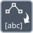

<!-- Generated by tools/export_studio_help.py; edit the reviewed source metadata, then regenerate. -->
# Path To String Array

[String functions](../index.md) · [All functions](../../index.md)

Splits a path into an array of strings.

Résumé français de l’aide Studio

**Chemin vers tableau de chaines**

Decompose un chemin en tableau de chaines. [Types] Un chemin scalaire produit un tableau 1D de chaînes (composants) et un booléen indiquant si le chemin est relatif.

## Studio authoring profile

Contract status: **partial**. The connector below describes Studio authoring; execution availability is stated separately.

A scalar Path yields a 1D String array of components and a Boolean relative-path flag.

A scalar Path yields a 1D String array of components and a Boolean relative-path flag.

## IN — inputs

| Displayed terminal / internal ID | Accepted / resolved type | Studio connection | Unwired input default | Meaning |
| --- | --- | --- | --- | --- |
| value `value` | `path` | Required | Not specified | — |

A default is shown only for an input with an explicitly documented value. Preview/default *types* do not imply unwired operand values. If helper and binding flags differ, both are labelled.

## OUT — outputs

| Displayed terminal / internal ID | Accepted / resolved type | Studio connection | Unwired input default | Meaning |
| --- | --- | --- | --- | --- |
| result `result` | `array<string,rank=1>` | Recommended (help); Required (binding) | — | — |
| relative `relative` | `bool` | Recommended (help); Required (binding) | — | — |

A default is shown only for an input with an explicitly documented value. Preview/default *types* do not imply unwired operand values. If helper and binding flags differ, both are labelled.

## Types and connection rules

A scalar Path yields a 1D String array of components and a Boolean relative-path flag.

- Type resolution: `fixed`; result expression: `declared_output_type`.
- Implicit coercion: not enabled by this resolver; individual port policies remain explicit.
- Arrays: not accepted; lifting policy: `none`.

**Input count:** 1; this contract does not enable variadic inputs.

## Execution and limits

**Public FROG / target Runtime:** not declared available by this authoring contract.

Scope: `requires_explicit_target_capability`.

Provider identity is retained from Studio. Executability must be established by the active target; it is not inferred from catalog visibility.

**Authoring/target contract limits:**

- NI reference verified for authoring types; this does not establish runtime support on the active target.

Connector type defaults and persistence aliases

| Direction | ID | Preview/default type | Connection policy | Cardinality | Legacy port IDs |
| --- | --- | --- | --- | --- | --- |
| INPUT | `value` | `path` | `any_explicit` | `single` | `path` |
| OUTPUT | `result` | `array<string>` | `any_explicit` | `single` | `array_of_strings` |
| OUTPUT | `relative` | `bool` | `any_explicit` | `single` | — |

## Identity and references

- Catalogue ID: `string.conversion.path_to_string_array`.
- Parent palette: [Conversion](../conversion.md).
- Profile: `frog.studio.polymorphic.string.conversion.path_to_string_array.v1`.
- Definition: `frog.studio.string.conversion.path_to_string_array`.
- [NI API reference](https://www.ni.com/docs/en-US/bundle/labview-api-ref/page/functions/path-to-array-of-strings.html).

NI links are reference sources for the connector model; Studio support is limited to the profile above. [Reference provenance and notation](../../index.md#provenance-and-notation).
