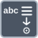

<!-- Generated by tools/export_studio_help.py; edit the reviewed source metadata, then regenerate. -->
# Scan From String

[String functions](../index.md) · [All functions](../../index.md)

Reads formatted values from a string.

Résumé français de l’aide Studio

**Balayer une chaine**

Lit des valeurs formatees depuis une chaine. [Types] Dérouler expose 1 à 32 couples défaut/sortie scalaires. Chaque sortie suit son propre défaut numérique/chaîne/chemin/booléen/enum/horodatage. Un format constant direct définit le nombre et les types chaîne, DBL ou horodatage des sorties sans défaut câblé. Tableaux/clusters refusés. Chaîne restante, décalage I32 et erreur gardent leurs types.

## Studio authoring profile

Contract status: **partial**. The connector below describes Studio authoring; execution availability is stated separately.

Resize for 1–32 paired scalar defaults/outputs. Each output follows its own numeric/String/Path/Boolean/enum/timestamp default. A direct constant format infers parameter count and String, DBL or timestamp outputs when defaults are unwired. Arrays/clusters are rejected. Remainder String, I32 offset and error stay separately typed.

Resize for 1–32 paired scalar defaults/outputs. Each output follows its own numeric/String/Path/Boolean/enum/timestamp default. A direct constant format infers parameter count and String, DBL or timestamp outputs when defaults are unwired. Arrays/clusters are rejected. Remainder String, I32 offset and error stay separately typed.

## IN — inputs

| Displayed terminal / internal ID | Accepted / resolved type | Studio connection | Unwired input default | Meaning |
| --- | --- | --- | --- | --- |
| format string `format_string` | `string` | Recommended (help); Optional (binding) | Not specified | — |
| value `value` | `string` | Required | Not specified | — |
| initial scan location `initial_scan_location` | `T:numeric` | Optional | Not specified | — |
| error in `error_in` | `cluster<status:bool,code:i32,source:string>` | Optional | Not specified | — |
| default value `default_value` | `T:any` | Optional | Not specified | — |

A default is shown only for an input with an explicitly documented value. Preview/default *types* do not imply unwired operand values. If helper and binding flags differ, both are labelled.

## OUT — outputs

| Displayed terminal / internal ID | Accepted / resolved type | Studio connection | Unwired input default | Meaning |
| --- | --- | --- | --- | --- |
| remaining string `remaining_string` | `string` | Recommended (help); Required (binding) | — | — |
| offset past scan `offset_past_scan` | `i32` | Recommended (help); Required (binding) | — | — |
| error out `error_out` | `cluster<status:bool,code:i32,source:string>` | Recommended (help); Required (binding) | — | — |
| result `result` | `T:any` | Recommended (help); Required (binding) | — | — |

A default is shown only for an input with an explicitly documented value. Preview/default *types* do not imply unwired operand values. If helper and binding flags differ, both are labelled.

Additional input IDs: `default_value_N`, starting at 2.

Expanded connector rows receive their live group/dimension number in Studio. Field selections and configured instances can also supply live names; the table documents the base connector and keeps its internal IDs separate.

## Types and connection rules

Resize for 1–32 paired scalar defaults/outputs. Each output follows its own numeric/String/Path/Boolean/enum/timestamp default. A direct constant format infers parameter count and String, DBL or timestamp outputs when defaults are unwired. Arrays/clusters are rejected. Remainder String, I32 offset and error stay separately typed.

- Type resolution: `custom_resolver`; result expression: `resolve:frog.studio.polymorphic.type-resolution@1`.
- Implicit coercion: not enabled by this resolver; individual port policies remain explicit.
- Arrays: not accepted; lifting policy: `none`.

**Expandable inputs:** 5 to 36. Reduction: `independent_scalar_parameters`.

Port order: `format_string` → `value` → `initial_scan_location` → `error_in` → `default_value` → `default_value_N_ascending`.

## Execution and limits

**Public FROG / target Runtime:** not declared available by this authoring contract.

Scope: `requires_explicit_target_capability`.

Provider identity is retained from Studio. Executability must be established by the active target; it is not inferred from catalog visibility.

**Authoring/target contract limits:**

- NI reference verified for authoring types; this does not establish runtime support on the active target.

Connector type defaults and persistence aliases

| Direction | ID | Preview/default type | Connection policy | Cardinality | Legacy port IDs |
| --- | --- | --- | --- | --- | --- |
| INPUT | `format_string` | `string` | `any_explicit` | `single` | — |
| INPUT | `value` | `string` | `any_explicit` | `single` | `input_string` |
| INPUT | `initial_scan_location` | `i32` | `numeric_implicit` | `single` | — |
| INPUT | `error_in` | `cluster<status:bool,code:i32,source:string>` | `any_explicit` | `single` | — |
| INPUT | `default_value` | `f64` | `any_explicit` | `single` | `default` |
| OUTPUT | `remaining_string` | `string` | `any_explicit` | `single` | — |
| OUTPUT | `offset_past_scan` | `i32` | `any_explicit` | `single` | — |
| OUTPUT | `error_out` | `cluster<status:bool,code:i32,source:string>` | `any_explicit` | `single` | — |
| OUTPUT | `result` | `f64` | `any_explicit` | `single` | `output` |

## Examples

No example for this object is currently declared in the shared index. [Browse the available examples](../../../examples/index.md).

## Identity and references

- Catalogue ID: `string.conversion.scan_from_string`.
- Parent palette: [Conversion](../conversion.md).
- Profile: `frog.studio.polymorphic.string.conversion.scan_from_string.v1`.
- Definition: `frog.studio.string.conversion.scan_from_string`.
- [NI API reference](https://www.ni.com/docs/en-US/bundle/labview-api-ref/page/functions/scan-from-string.html).

NI links are reference sources for the connector model; Studio support is limited to the profile above. [Reference provenance and notation](../../index.md#provenance-and-notation).
