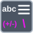

<!-- Generated by tools/export_studio_help.py; edit the reviewed source metadata, then regenerate. -->
# Escape String

[String functions](index.md) · [All functions](../index.md)

Processes escape characters in a string.

Résumé français de l’aide Studio

**Chaine d'echappement**

Traite les caracteres d'echappement d'une chaine. [Types] Référence NI NXG : chaîne scalaire, tableau 1D de clusters {String:chaîne, Escape:chaîne} et enum U16 échapper/déséchapper produisent une chaîne. Escapes est un TABLEAU de paires, pas un cluster isolé.

## Studio authoring profile

Contract status: **partial**. The connector below describes Studio authoring; execution availability is stated separately.

NI NXG reference: scalar String, a 1D array of {String:String, Escape:String} clusters and U16 escape/unescape enum produce one String. Escapes is an ARRAY of pairs, not a single cluster.

NI NXG reference: scalar String, a 1D array of {String:String, Escape:String} clusters and U16 escape/unescape enum produce one String. Escapes is an ARRAY of pairs, not a single cluster.

## IN — inputs

| Displayed terminal / internal ID | Accepted / resolved type | Studio connection | Unwired input default | Meaning |
| --- | --- | --- | --- | --- |
| value `value` | `string` | Required | Not specified | — |
| escapes `escapes` | `array<cluster<String:string,Escape:string>,rank=1>` | Required | Not specified | — |
| escape mode `escape_mode` | `enum<escape_mode,u16>` | Optional | Not specified | — |

A default is shown only for an input with an explicitly documented value. Preview/default *types* do not imply unwired operand values. If helper and binding flags differ, both are labelled.

## OUT — outputs

| Displayed terminal / internal ID | Accepted / resolved type | Studio connection | Unwired input default | Meaning |
| --- | --- | --- | --- | --- |
| result `result` | `string` | Required | — | — |

A default is shown only for an input with an explicitly documented value. Preview/default *types* do not imply unwired operand values. If helper and binding flags differ, both are labelled.

## Types and connection rules

NI NXG reference: scalar String, a 1D array of {String:String, Escape:String} clusters and U16 escape/unescape enum produce one String. Escapes is an ARRAY of pairs, not a single cluster.

- Type resolution: `fixed`; result expression: `declared_output_type`.
- Implicit coercion: not enabled by this resolver; individual port policies remain explicit.
- Arrays: accepted; lifting policy: `none`.

**Input count:** 3; this contract does not enable variadic inputs.

## Execution and limits

**Public FROG / target Runtime:** not declared available by this authoring contract.

Scope: `requires_explicit_target_capability`.

Provider identity is retained from Studio. Executability must be established by the active target; it is not inferred from catalog visibility.

**Authoring/target contract limits:**

- NI reference verified for authoring types; this does not establish runtime support on the active target.

Connector type defaults and persistence aliases

| Direction | ID | Preview/default type | Connection policy | Cardinality | Legacy port IDs |
| --- | --- | --- | --- | --- | --- |
| INPUT | `value` | `string` | `any_explicit` | `single` | `string` |
| INPUT | `escapes` | `array<cluster<String:string,Escape:string>>` | `any_explicit` | `single` | — |
| INPUT | `escape_mode` | `enum<escape_mode,u16>` | `any_explicit` | `single` | — |
| OUTPUT | `result` | `string` | `any_explicit` | `single` | `result_string` |

## Identity and references

- Catalogue ID: `string.escape`.
- Profile: `frog.studio.polymorphic.string.escape.v1`.
- Definition: `frog.studio.string.escape`.
- [NI API reference](https://www.ni.com/docs/en-US/bundle/labview-nxg-nodes-api-ref/page/escape-string.html).

NI links are reference sources for the connector model; Studio support is limited to the profile above. [Reference provenance and notation](../index.md#provenance-and-notation).
