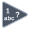

<!-- Generated by tools/export_studio_help.py; edit the reviewed source metadata, then regenerate. -->
# Lexical Class

[String functions](index.md) · [All functions](../index.md)

Tests the lexical class of a character.

Résumé français de l’aide Studio

**Classe lexicale**

Teste la classe lexicale d'un caractere. [Types] Chaînes ou codes ASCII numériques réels, scalaires/tableaux/clusters, produisent des classes lexicales I16 (0 à 6) de mêmes rangs et structure.

## Studio authoring profile

Contract status: **partial**. The connector below describes Studio authoring; execution availability is stated separately.

String or real numeric ASCII-code scalars/arrays/clusters produce I16 lexical class codes (0–6) with the same ranks and cluster structure.

String or real numeric ASCII-code scalars/arrays/clusters produce I16 lexical class codes (0–6) with the same ranks and cluster structure.

## IN — inputs

| Displayed terminal / internal ID | Accepted / resolved type | Studio connection | Unwired input default | Meaning |
| --- | --- | --- | --- | --- |
| char `value` | `T:any` | Required | Not specified | — |

A default is shown only for an input with an explicitly documented value. Preview/default *types* do not imply unwired operand values. If helper and binding flags differ, both are labelled.

## OUT — outputs

| Displayed terminal / internal ID | Accepted / resolved type | Studio connection | Unwired input default | Meaning |
| --- | --- | --- | --- | --- |
| lexical class number `result` | `T:any` | Recommended (help); Required (binding) | — | — |

A default is shown only for an input with an explicitly documented value. Preview/default *types* do not imply unwired operand values. If helper and binding flags differ, both are labelled.

## Types and connection rules

String or real numeric ASCII-code scalars/arrays/clusters produce I16 lexical class codes (0–6) with the same ranks and cluster structure.

- Type resolution: `custom_resolver`; result expression: `resolve:frog.studio.polymorphic.type-resolution@1`.
- Implicit coercion: not enabled by this resolver; individual port policies remain explicit.
- Arrays: accepted; lifting policy: `none`.

**Input count:** 1; this contract does not enable variadic inputs.

## Execution and limits

**Public FROG / target Runtime:** not declared available by this authoring contract.

Scope: `requires_explicit_target_capability`.

Provider identity is retained from Studio. Executability must be established by the active target; it is not inferred from catalog visibility.

**Authoring/target contract limits:**

- NI reference verified for authoring types; this does not establish runtime support on the active target.

Connector type defaults and persistence aliases

| Direction | ID | Preview/default type | Connection policy | Cardinality | Legacy port IDs |
| --- | --- | --- | --- | --- | --- |
| INPUT | `value` | `string` | `any_explicit` | `single` | `char`, `character` |
| OUTPUT | `result` | `i16` | `any_explicit` | `single` | `class_number` |

## Identity and references

- Catalogue ID: `string.lexical_class`.
- Profile: `frog.studio.polymorphic.string.lexical_class.v1`.
- Definition: `frog.studio.string.lexical_class`.
- [NI API reference](https://www.ni.com/docs/en-US/bundle/labview-api-ref/page/functions/lexical-class.html).

NI links are reference sources for the connector model; Studio support is limited to the profile above. [Reference provenance and notation](../index.md#provenance-and-notation).
