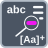

<!-- Generated by tools/export_studio_help.py; edit the reviewed source metadata, then regenerate. -->
# Match Regular Expression

[String functions](index.md) · [All functions](../index.md)

Matches a regular expression inside a string.

Résumé français de l’aide Studio

**Rechercher une expression reguliere**

Recherche une expression reguliere dans une chaine. [Types] Chaîne et expression régulière scalaires, décalage numérique, booléens multiligne/ignorer la casse et erreur produisent les chaînes avant/correspondance/après, un décalage I32, une erreur et 1 à 32 sous-correspondances déroulables.

## Studio authoring profile

Contract status: **partial**. The connector below describes Studio authoring; execution availability is stated separately.

Scalar String/regular expression, numeric offset, Boolean multiline/ignore-case and error cluster yield before/whole/after Strings, I32 offset, error and 1–32 expandable String submatches.

Scalar String/regular expression, numeric offset, Boolean multiline/ignore-case and error cluster yield before/whole/after Strings, I32 offset, error and 1–32 expandable String submatches.

## IN — inputs

| Displayed terminal / internal ID | Accepted / resolved type | Studio connection | Unwired input default | Meaning |
| --- | --- | --- | --- | --- |
| value `value` | `string` | Required | Not specified | — |
| regular expression `regular_expression` | `string` | Required | Not specified | — |
| offset `offset` | `T:numeric` | Optional | Not specified | — |
| multiline `multiline` | `bool` | Optional | Not specified | — |
| ignore case `ignore_case` | `bool` | Optional | Not specified | — |
| error in `error_in` | `cluster<status:bool,code:i32,source:string>` | Optional | Not specified | — |

A default is shown only for an input with an explicitly documented value. Preview/default *types* do not imply unwired operand values. If helper and binding flags differ, both are labelled.

## OUT — outputs

| Displayed terminal / internal ID | Accepted / resolved type | Studio connection | Unwired input default | Meaning |
| --- | --- | --- | --- | --- |
| before match `before_match` | `string` | Required | — | — |
| whole match `whole_match` | `string` | Required | — | — |
| after match `after_match` | `string` | Required | — | — |
| offset past match `offset_past_match` | `i32` | Required | — | — |
| error out `error_out` | `cluster<status:bool,code:i32,source:string>` | Required | — | — |
| submatch `submatch` | `string` | Required | — | — |

A default is shown only for an input with an explicitly documented value. Preview/default *types* do not imply unwired operand values. If helper and binding flags differ, both are labelled.

## Types and connection rules

Scalar String/regular expression, numeric offset, Boolean multiline/ignore-case and error cluster yield before/whole/after Strings, I32 offset, error and 1–32 expandable String submatches.

- Type resolution: `custom_resolver`; result expression: `resolve:frog.studio.polymorphic.type-resolution@1`.
- Implicit coercion: not enabled by this resolver; individual port policies remain explicit.
- Arrays: not accepted; lifting policy: `none`.

**Input count:** 6; this contract does not enable variadic inputs.

## Execution and limits

**Public FROG / target Runtime:** not declared available by this authoring contract.

Scope: `requires_explicit_target_capability`.

Provider identity is retained from Studio. Executability must be established by the active target; it is not inferred from catalog visibility.

**Authoring/target contract limits:**

- NI reference verified for authoring types; this does not establish runtime support on the active target.

Connector type defaults and persistence aliases

| Direction | ID | Preview/default type | Connection policy | Cardinality | Legacy port IDs |
| --- | --- | --- | --- | --- | --- |
| INPUT | `value` | `string` | `any_explicit` | `single` | `input_string` |
| INPUT | `regular_expression` | `string` | `any_explicit` | `single` | `pattern` |
| INPUT | `offset` | `i32` | `numeric_implicit` | `single` | — |
| INPUT | `multiline` | `bool` | `any_explicit` | `single` | — |
| INPUT | `ignore_case` | `bool` | `any_explicit` | `single` | — |
| INPUT | `error_in` | `cluster<status:bool,code:i32,source:string>` | `any_explicit` | `single` | — |
| OUTPUT | `before_match` | `string` | `any_explicit` | `single` | — |
| OUTPUT | `whole_match` | `string` | `any_explicit` | `single` | `result` |
| OUTPUT | `after_match` | `string` | `any_explicit` | `single` | — |
| OUTPUT | `offset_past_match` | `i32` | `any_explicit` | `single` | — |
| OUTPUT | `error_out` | `cluster<status:bool,code:i32,source:string>` | `any_explicit` | `single` | — |
| OUTPUT | `submatch` | `string` | `any_explicit` | `single` | — |

## Identity and references

- Catalogue ID: `string.match_regular_expression`.
- Profile: `frog.studio.polymorphic.string.match_regular_expression.v1`.
- Definition: `frog.studio.string.match_regular_expression`.
- [NI API reference](https://www.ni.com/docs/en-US/bundle/labview-api-ref/page/vi-lib/regexp/match-regular-expression-xnode.html).

NI links are reference sources for the connector model; Studio support is limited to the profile above. [Reference provenance and notation](../index.md#provenance-and-notation).
