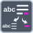

<!-- Generated by tools/export_studio_help.py; edit the reviewed source metadata, then regenerate. -->
# Search String

[String functions](index.md) · [All functions](../index.md)

Searches for text inside a string.

Résumé français de l’aide Studio

**Rechercher une chaine**

Recherche un texte dans une chaine. [Types] Correspondance de la première chaîne accepte une chaîne scalaire et un tableau 1D de préfixes. Sorties : chaîne restante et indice I32 du préfixe trouvé, pas un booléen.

## Studio authoring profile

Contract status: **partial**. The connector below describes Studio authoring; execution availability is stated separately.

Match First String accepts one scalar String and a 1D String array of prefixes. Outputs are the remaining String and an I32 matching-prefix index, not a Boolean.

Match First String accepts one scalar String and a 1D String array of prefixes. Outputs are the remaining String and an I32 matching-prefix index, not a Boolean.

## IN — inputs

| Displayed terminal / internal ID | Accepted / resolved type | Studio connection | Unwired input default | Meaning |
| --- | --- | --- | --- | --- |
| value `value` | `string` | Required (help); Optional (binding) | Not specified | — |
| string array `string_array` | `array<string,rank=1>` | Required | Not specified | — |

A default is shown only for an input with an explicitly documented value. Preview/default *types* do not imply unwired operand values. If helper and binding flags differ, both are labelled.

## OUT — outputs

| Displayed terminal / internal ID | Accepted / resolved type | Studio connection | Unwired input default | Meaning |
| --- | --- | --- | --- | --- |
| result `result` | `string` | Recommended (help); Required (binding) | — | — |
| index `index` | `i32` | Recommended (help); Required (binding) | — | — |

A default is shown only for an input with an explicitly documented value. Preview/default *types* do not imply unwired operand values. If helper and binding flags differ, both are labelled.

## Types and connection rules

Match First String accepts one scalar String and a 1D String array of prefixes. Outputs are the remaining String and an I32 matching-prefix index, not a Boolean.

- Type resolution: `fixed`; result expression: `declared_output_type`.
- Implicit coercion: not enabled by this resolver; individual port policies remain explicit.
- Arrays: accepted; lifting policy: `none`.

**Input count:** 2; this contract does not enable variadic inputs.

## Execution and limits

**Public FROG / target Runtime:** not declared available by this authoring contract.

Scope: `requires_explicit_target_capability`.

Provider identity is retained from Studio. Executability must be established by the active target; it is not inferred from catalog visibility.

**Authoring/target contract limits:**

- NI reference verified for authoring types; this does not establish runtime support on the active target.

Connector type defaults and persistence aliases

| Direction | ID | Preview/default type | Connection policy | Cardinality | Legacy port IDs |
| --- | --- | --- | --- | --- | --- |
| INPUT | `value` | `string` | `any_explicit` | `single` | `string` |
| INPUT | `string_array` | `array<string>` | `any_explicit` | `single` | — |
| OUTPUT | `result` | `string` | `any_explicit` | `single` | `output_string` |
| OUTPUT | `index` | `i32` | `any_explicit` | `single` | — |

## Examples

No example for this object is currently declared in the shared index. [Browse the available examples](../../examples/index.md).

## Identity and references

- Catalogue ID: `string.search`.
- Profile: `frog.studio.polymorphic.string.search.v1`.
- Definition: `frog.studio.string.search`.
- [NI API reference](https://www.ni.com/docs/en-US/bundle/labview-api-ref/page/functions/match-first-string.html).

NI links are reference sources for the connector model; Studio support is limited to the profile above. [Reference provenance and notation](../index.md#provenance-and-notation).
