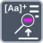

<!-- Generated by tools/export_studio_help.py; edit the reviewed source metadata, then regenerate. -->
# Search And Replace Pattern

[String functions](index.md) · [All functions](../index.md)

Searches for a pattern and replaces matching text.

Résumé français de l’aide Studio

**Rechercher et remplacer une expression**

Recherche une expression et remplace le texte correspondant. [Types] Chaînes scalaires source/motif/remplacement, décalage I32 et booléen tout remplacer facultatifs produisent une chaîne modifiée et le décalage I32 après correspondance.

## Studio authoring profile

Contract status: **partial**. The connector below describes Studio authoring; execution availability is stated separately.

Scalar String/pattern/replacement, optional I32 offset and Boolean replace-all yield an edited String and I32 offset past match.

Scalar String/pattern/replacement, optional I32 offset and Boolean replace-all yield an edited String and I32 offset past match.

## IN — inputs

| Displayed terminal / internal ID | Accepted / resolved type | Studio connection | Unwired input default | Meaning |
| --- | --- | --- | --- | --- |
| value `value` | `string` | Required | Not specified | — |
| regular expression `regular_expression` | `string` | Recommended (help); Optional (binding) | Not specified | — |
| replace string `replace_string` | `string` | Recommended (help); Optional (binding) | Not specified | — |
| offset `offset` | `T:numeric` | Optional | Not specified | — |
| replace all `replace_all` | `bool` | Optional | Not specified | — |

A default is shown only for an input with an explicitly documented value. Preview/default *types* do not imply unwired operand values. If helper and binding flags differ, both are labelled.

## OUT — outputs

| Displayed terminal / internal ID | Accepted / resolved type | Studio connection | Unwired input default | Meaning |
| --- | --- | --- | --- | --- |
| result `result` | `string` | Recommended (help); Required (binding) | — | — |
| offset past match `offset_past_match` | `i32` | Recommended (help); Required (binding) | — | — |

A default is shown only for an input with an explicitly documented value. Preview/default *types* do not imply unwired operand values. If helper and binding flags differ, both are labelled.

## Types and connection rules

Scalar String/pattern/replacement, optional I32 offset and Boolean replace-all yield an edited String and I32 offset past match.

- Type resolution: `fixed`; result expression: `declared_output_type`.
- Implicit coercion: not enabled by this resolver; individual port policies remain explicit.
- Arrays: not accepted; lifting policy: `none`.

**Input count:** 5; this contract does not enable variadic inputs.

## Execution and limits

**Public FROG / target Runtime:** not declared available by this authoring contract.

Scope: `requires_explicit_target_capability`.

Provider identity is retained from Studio. Executability must be established by the active target; it is not inferred from catalog visibility.

**Authoring/target contract limits:**

- NI reference verified for authoring types; this does not establish runtime support on the active target.

Connector type defaults and persistence aliases

| Direction | ID | Preview/default type | Connection policy | Cardinality | Legacy port IDs |
| --- | --- | --- | --- | --- | --- |
| INPUT | `value` | `string` | `any_explicit` | `single` | `string` |
| INPUT | `regular_expression` | `string` | `any_explicit` | `single` | `pattern` |
| INPUT | `replace_string` | `string` | `any_explicit` | `single` | — |
| INPUT | `offset` | `i32` | `numeric_implicit` | `single` | — |
| INPUT | `replace_all` | `bool` | `any_explicit` | `single` | — |
| OUTPUT | `result` | `string` | `any_explicit` | `single` | `result_string` |
| OUTPUT | `offset_past_match` | `i32` | `any_explicit` | `single` | — |

## Identity and references

- Catalogue ID: `string.search_replace_pattern`.
- Profile: `frog.studio.polymorphic.string.search_replace_pattern.v1`.
- Definition: `frog.studio.string.search_replace_pattern`.
- [NI API reference](https://www.ni.com/docs/en-US/bundle/labview-api-ref/page/vi-lib/utility/error-llb/search-and-replace-pattern-string-vi.html).

NI links are reference sources for the connector model; Studio support is limited to the profile above. [Reference provenance and notation](../index.md#provenance-and-notation).
