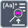

<!-- Generated by tools/export_studio_help.py; edit the reviewed source metadata, then regenerate. -->
# Search And Replace Pattern

[String functions](index.md) · [All functions](../index.md)

Searches for a pattern and replaces matching text.

## Product execution profiles

The shared index declares native examples for this object; see [the examples below](search_replace_pattern.md#examples) and [document profiles and evidence boundaries](../../reference/studio-draft-examples.md). Older binding/help statements retained below can lag those product profiles. They do not establish or deny the separately measured native profiles. An example declaration alone is not an execution result or admission of every overload.

Résumé français de l’aide Studio

**Rechercher et remplacer une expression**

Texte historique de l’aide conservé ci-dessous. Des exemples natifs distincts sont déclarés pour cet objet ; consultez les profils et preuves datés, sans déduire une compatibilité universelle de ce texte.

Recherche une expression et remplace le texte correspondant.

## Studio authoring profile

Contract status: **partial**. The connector below describes Studio authoring; execution availability is stated separately.

## IN — inputs

| Displayed terminal / internal ID | Accepted / resolved type | Studio connection | Unwired input default | Meaning |
| --- | --- | --- | --- | --- |
| value `value` | `string` | Required | Not specified | — |
| regular expression `regular_expression` | `string` | Recommended (help); Optional (binding) | Not specified | — |
| replace string `replace_string` | `string` | Recommended (help); Optional (binding) | Not specified | — |
| offset `offset` | `T:numeric` | Optional | Not specified | — |
| replace all `replace_all` | `bool` | Optional | Not specified | — |

A default is shown only for an input with an explicitly documented value. Preview/default *types* do not imply unwired operand values. If helper and binding flags differ, both are labelled.

## OUT — outputs

| Displayed terminal / internal ID | Accepted / resolved type | Studio connection | Unwired input default | Meaning |
| --- | --- | --- | --- | --- |
| result `result` | `string` | Recommended (help); Required (binding) | — | — |
| offset past match `offset_past_match` | `i32` | Recommended (help); Required (binding) | — | — |

A default is shown only for an input with an explicitly documented value. Preview/default *types* do not imply unwired operand values. If helper and binding flags differ, both are labelled.

## Types and Compatibility

The notes below retain the reviewed help's original NI and Studio scopes. An NI overload is not a claim of Studio runtime support; the authoring profile and execution limits remain separate.

Retained binding and help statements

These are source declarations, not the current measured product-execution assessment. Compare historical limitations with the separately dated native profiles above.

Scalar String/pattern/replacement, optional I32 offset and Boolean replace-all yield an edited String and I32 offset past match.

Notes de types et de compatibilité de l’aide Studio

Les mentions NI et Studio gardent leur portée d’origine. Une variante NI ne constitue pas une déclaration de prise en charge par le runtime Studio ; consultez les profils et limites d’exécution de cette fiche.

Chaînes scalaires source/motif/remplacement, décalage I32 et booléen tout remplacer facultatifs produisent une chaîne modifiée et le décalage I32 après correspondance.

- Type resolution: `fixed`; result expression: `declared_output_type`.
- Implicit coercion: not enabled by this resolver; individual port policies remain explicit.
- Arrays: not accepted; lifting policy: `none`.

**Input count:** 5; this contract does not enable variadic inputs.

## Execution and limits

**Public FROG / target Runtime:** not declared available by this authoring contract.

Scope: `requires_explicit_target_capability`.

Provider identity is retained from Studio. Executability must be established by the active target; it is not inferred from catalog visibility.

Retained authoring-contract limitations

These declarations belong to the binding snapshot. Compare them with the separately admitted native profiles and dated measurements linked above; they are not a current denial of those product profiles.

**Authoring/target contract limits:**

- NI reference verified for authoring types; this does not establish runtime support on the active target.

Connector type defaults and persistence aliases

| Direction | ID | Preview/default type | Connection policy | Cardinality | Legacy port IDs |
| --- | --- | --- | --- | --- | --- |
| INPUT | `value` | `string` | `any_explicit` | `single` | `string` |
| INPUT | `regular_expression` | `string` | `any_explicit` | `single` | `pattern` |
| INPUT | `replace_string` | `string` | `any_explicit` | `single` | — |
| INPUT | `offset` | `i32` | `numeric_implicit` | `single` | — |
| INPUT | `replace_all` | `bool` | `any_explicit` | `single` | — |
| OUTPUT | `result` | `string` | `any_explicit` | `single` | `result_string` |
| OUTPUT | `offset_past_match` | `i32` | `any_explicit` | `single` | — |

## Examples

These are real `.frog` documents from the same index used by Studio. Backend names and expected results describe the examples; they are not execution certificates.

- [Search And Replace Pattern](../../examples/string.search_replace_pattern.worked.md) — With value = "a12b34c", regular_expression = "\[0-9\]+", replace_string = "#", replace_all = false, Run displays result = "a#b34c", offset_past_match = 2. (`execution`, `studio-draft`).

## Identity and references

- Catalogue ID: `string.search_replace_pattern`.
- Profile: `frog.studio.polymorphic.string.search_replace_pattern.v1`.
- Definition: `frog.studio.string.search_replace_pattern`.
- [NI API reference](https://www.ni.com/docs/en-US/bundle/labview-api-ref/page/vi-lib/utility/error-llb/search-and-replace-pattern-string-vi.html).

NI links are reference sources for the connector model; Studio support is limited to the profile above. [Reference provenance and notation](../index.md#provenance-and-notation).
