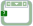

<!-- Generated by tools/export_studio_help.py; edit the reviewed source metadata, then regenerate. -->
# Case Structure

[Structures functions](index.md) · [All functions](../index.md)

Places a resizable Boolean Case Structure with True and False cases on the Diagram.

Résumé français de l’aide Studio

**Structure Condition**

Place sur le diagramme une Structure Condition booleenne redimensionnable avec les cas Vrai et Faux. [Types] Sélecteur booléen, entier, enum, String ou erreur ; types des tunnels compatibles entre cas. Studio: Le domaine du sélecteur de Studio est défini par le contrat de la structure Case ; toutes les surcharges de sélecteur de NI ne sont pas implémentées.

## Studio authoring profile

Contract status: **partial**. The connector below describes Studio authoring; execution availability is stated separately.

Boolean, integer, enum, String or error selector; data tunnels require compatible types across cases. Studio: Studio selector domain is defined by its Case contract; not every NI selector overload is implemented.

## IN — inputs

| Displayed terminal / internal ID | Accepted / resolved type | Studio connection | Unwired input default | Meaning |
| --- | --- | --- | --- | --- |
| selector `selector` | `T:case_selector` | Required | Not specified | — |

A default is shown only for an input with an explicitly documented value. Preview/default *types* do not imply unwired operand values. If helper and binding flags differ, both are labelled.

## OUT — outputs

| Displayed terminal / internal ID | Accepted / resolved type | Studio connection | Unwired input default | Meaning |
| --- | --- | --- | --- | --- |
| selected case `selected_case` | `same(selector)` | Required | — | — |

A default is shown only for an input with an explicitly documented value. Preview/default *types* do not imply unwired operand values. If helper and binding flags differ, both are labelled.

## Types and connection rules

Historical Studio binding profile; no additional public FROG semantics are claimed.

- Type resolution: `pass_through`; result expression: `same(selector)`.
- Implicit coercion: not enabled by this resolver; individual port policies remain explicit.
- Arrays: not established; lifting policy: `none`.

Only the declared port expressions and connection policies are defined by this Studio profile; general array semantics remain unspecified.

**Input count:** 1; this contract does not enable variadic inputs.

## Execution and limits

**Public FROG / target Runtime:** not declared available by this authoring contract.

Scope: `requires_explicit_target_capability`.

Provider identity is retained from Studio. Executability must be established by the active target; it is not inferred from catalog visibility.

**Authoring/target contract limits:**

- The complete public execution semantics and target support for this legacy Studio profile have not been established.

Connector type defaults and persistence aliases

| Direction | ID | Preview/default type | Connection policy | Cardinality | Legacy port IDs |
| --- | --- | --- | --- | --- | --- |
| INPUT | `selector` | `bool` | `any_explicit` | `single` | — |
| OUTPUT | `selected_case` | `bool` | `exact` | `single` | — |

## Identity and references

- Catalogue ID: `structures.case_structure`.
- Profile: `frog.studio.legacy.structures.case_structure.v1`.
- Definition: `frog.studio.structures.case_structure`.
- [NI API reference](https://www.ni.com/docs/en-US/bundle/labview-nxg-nodes-api-ref/page/case-structure.html).

NI links are reference sources for the connector model; Studio support is limited to the profile above. [Reference provenance and notation](../index.md#provenance-and-notation).
