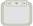

<!-- Generated by tools/export_studio_help.py; edit the reviewed source metadata, then regenerate. -->
# Diagram Disable Structure

[Structures functions](index.md) · [All functions](../index.md)

Retains Enabled and Disabled code regions without a condition terminal. Only the Enabled region executes; the Disabled region is shown under a translucent veil.

Résumé français de l’aide Studio

**Structure de desactivation du diagramme**

Conserve les regions de code Active et Desactivee sans terminal de condition. Seule la region Active s'execute ; la region Desactivee apparait sous un voile translucide. [Types] Sans opérande sélecteur ; diagramme actif et tunnels typés déterminent le flux. Studio : contrat de bornes appelables pas encore implémenté. Studio: Structure gérée par l’éditeur.

## Studio authoring profile

Contract status: **blocked**. The connector below describes Studio authoring; execution availability is stated separately.

No selector operand; active diagram and typed tunnels determine dataflow. Studio: callable connector contract not yet implemented. Studio: Editor-managed structure.

## IN — inputs

No fixed inputs are declared in this binding profile. The editor or selected instance owns any contextual terminals.

## OUT — outputs

No fixed outputs are declared in this binding profile. The editor or selected instance owns any contextual terminals.

## Types and connection rules

Historical Studio binding profile; no additional public FROG semantics are claimed.

- Type resolution: `fixed`; result expression: `undecided`.
- Implicit coercion: not enabled by this resolver; individual port policies remain explicit.
- Arrays: not established; lifting policy: `none`.

Only the declared port expressions and connection policies are defined by this Studio profile; general array semantics remain unspecified.

Input count is instance-dependent or not established by this contract.

## Execution and limits

**Public FROG / target Runtime:** not declared available by this authoring contract.

Scope: `requires_explicit_target_capability`.

Provider identity is retained from Studio. Executability must be established by the active target; it is not inferred from catalog visibility.

**Authoring/target contract limits:**

- The complete public execution semantics and target support for this legacy Studio profile have not been established.

Connector type defaults and persistence aliases

| Direction | ID | Preview/default type | Connection policy | Cardinality | Legacy port IDs |
| --- | --- | --- | --- | --- | --- |

## Examples

These are real `.frog` documents from the same index used by Studio. Backend names and expected results describe the examples; they are not execution certificates.

- [Diagram Disable : la branche visible n'est pas la branche active](../../examples/structure.diagram_disable.hidden_enabled.md) — Diagram Disable : la branche visible n'est pas la branche active (`persistence`, `studio-draft`).

## Identity and references

- Catalogue ID: `structures.disabled_structure`.
- Profile: `frog.studio.legacy.structures.disabled_structure.v1`.
- Definition: `frog.studio.structures.disabled_structure`.
- [NI API reference](https://www.ni.com/docs/en-US/bundle/labview-nxg-nodes-api-ref/page/disable-structure.html).

NI links are reference sources for the connector model; Studio support is limited to the profile above. [Reference provenance and notation](../index.md#provenance-and-notation).
