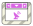

<!-- Generated by tools/export_studio_help.py; edit the reviewed source metadata, then regenerate. -->
# Event Structure

[Structures functions](index.md) · [All functions](../index.md)

Places a resizable event-case container with a fixed timeout interface and a vertically movable typed Event Data Node.

## Product execution profiles

The shared index declares native examples for this object; see [the examples below](event_structure.md#examples) and [document profiles and evidence boundaries](../../reference/studio-draft-examples.md). Older binding/help statements retained below can lag those product profiles. They do not establish or deny the separately measured native profiles. An example declaration alone is not an execution result or admission of every overload.

Résumé français de l’aide Studio

**Structure Event**

Texte historique de l’aide conservé ci-dessous. Des exemples natifs distincts sont déclarés pour cet objet ; consultez les profils et preuves datés, sans déduire une compatibilité universelle de ce texte.

Place un conteneur de cases evenementiels redimensionnable avec une interface timeout fixe et un Event Data Node type, mobile verticalement. [Types] Timeout entier ; cluster de données propre à l’événement ; tunnels typés. Studio: Les données d’événement et les tunnels sont générés par le modèle d’événements de Studio.

## Studio authoring profile

Contract status: **partial**. The connector below describes Studio authoring; execution availability is stated separately.

Retained binding and help description

This is the source declaration, not the current measured product-execution assessment.

Integer timeout; event-specific data cluster; typed tunnels. Studio: Event data and tunnels are generated by the Studio event model.

## IN — inputs

| Displayed terminal / internal ID | Accepted / resolved type | Studio connection | Unwired input default | Meaning |
| --- | --- | --- | --- | --- |
| timeout milliseconds `timeout` | `i64` | Required | Not specified | — |

A default is shown only for an input with an explicitly documented value. Preview/default *types* do not imply unwired operand values. If helper and binding flags differ, both are labelled.

## OUT — outputs

| Displayed terminal / internal ID | Accepted / resolved type | Studio connection | Unwired input default | Meaning |
| --- | --- | --- | --- | --- |
| timeout value `timeout_value` | `i64` | Required | — | — |
| Source `event_data.source` | `string` | Required | — | — |
| Type `event_data.type` | `string` | Required | — | — |
| Time `event_data.time` | `u64` | Required | — | — |

A default is shown only for an input with an explicitly documented value. Preview/default *types* do not imply unwired operand values. If helper and binding flags differ, both are labelled.

## Types and connection rules

Historical Studio binding profile; no additional public FROG semantics are claimed.

- Type resolution: `fixed`; result expression: `i64;string;string;u64`.
- Implicit coercion: not enabled by this resolver; individual port policies remain explicit.
- Arrays: not established; lifting policy: `none`.

Only the declared port expressions and connection policies are defined by this Studio profile; general array semantics remain unspecified.

**Input count:** 1; this contract does not enable variadic inputs.

## Execution and limits

**Public FROG / target Runtime:** not declared available by this authoring contract.

Scope: `requires_explicit_target_capability`.

Provider identity is retained from Studio. Executability must be established by the active target; it is not inferred from catalog visibility.

Retained authoring-contract limitations

These declarations belong to the binding snapshot. Compare them with the separately admitted native profiles and dated measurements linked above; they are not a current denial of those product profiles.

**Authoring/target contract limits:**

- The complete public execution semantics and target support for this legacy Studio profile have not been established.

Connector type defaults and persistence aliases

| Direction | ID | Preview/default type | Connection policy | Cardinality | Legacy port IDs |
| --- | --- | --- | --- | --- | --- |
| INPUT | `timeout` | `i64` | `exact` | `single` | — |
| OUTPUT | `timeout_value` | `i64` | `exact` | `single` | — |
| OUTPUT | `event_data.source` | `string` | `exact` | `single` | — |
| OUTPUT | `event_data.type` | `string` | `exact` | `single` | — |
| OUTPUT | `event_data.time` | `u64` | `exact` | `single` | — |

## Examples

These are real `.frog` documents from the same index used by Studio. Backend names and expected results describe the examples; they are not execution certificates.

- [Event : traiter un Timeout immédiat](../../examples/structure.event.timeout_zero.md) — Event : traiter un Timeout immédiat (`execution`, `studio-draft`).

## Identity and references

- Catalogue ID: `structures.event_structure`.
- Profile: `frog.studio.legacy.structures.event_structure.v1`.
- Definition: `frog.studio.structures.event_structure`.
- [NI API reference](https://www.ni.com/docs/en-US/bundle/labview-nxg-nodes-api-ref/page/event-structure.html).

NI links are reference sources for the connector model; Studio support is limited to the profile above. [Reference provenance and notation](../index.md#provenance-and-notation).
