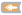

<!-- Generated by tools/export_studio_help.py; edit the reviewed source metadata, then regenerate. -->
# Feedback Node

[Structures functions](index.md) · [All functions](../index.md)

Places the Feedback Node glyph on the Diagram.

Résumé français de l’aide Studio

**Noeud de retroaction**

Place le glyphe Noeud de retroaction sur le diagramme. [Types] Valeur:T, initialisation:T, enable:Boolean -&gt; T précédent, schéma et rangs conservés.

## Studio authoring profile

Contract status: **partial**. The connector below describes Studio authoring; execution availability is stated separately.

Value:T, initializer:T, enable:Boolean -&gt; previous T, preserving all schema/rank information.

## IN — inputs

| Displayed terminal / internal ID | Accepted / resolved type | Studio connection | Unwired input default | Meaning |
| --- | --- | --- | --- | --- |
| initial value `initial_value` | `same(value)` | Optional | Not specified | — |
| value `value` | `T:any` | Required | Not specified | — |
| enable? `enable` | `bool` | Optional | Not specified | — |

A default is shown only for an input with an explicitly documented value. Preview/default *types* do not imply unwired operand values. If helper and binding flags differ, both are labelled.

## OUT — outputs

| Displayed terminal / internal ID | Accepted / resolved type | Studio connection | Unwired input default | Meaning |
| --- | --- | --- | --- | --- |
| result `result` | `same(value)` | Required | — | — |

A default is shown only for an input with an explicitly documented value. Preview/default *types* do not imply unwired operand values. If helper and binding flags differ, both are labelled.

## Types and connection rules

Historical Studio binding profile; no additional public FROG semantics are claimed.

- Type resolution: `pass_through`; result expression: `same(value)`.
- Implicit coercion: not enabled by this resolver; individual port policies remain explicit.
- Arrays: not established; lifting policy: `none`.

Only the declared port expressions and connection policies are defined by this Studio profile; general array semantics remain unspecified.

**Input count:** 3; this contract does not enable variadic inputs.

## Execution and limits

**Public FROG / target Runtime:** not declared available by this authoring contract.

Scope: `requires_explicit_target_capability`.

Provider identity is retained from Studio. Executability must be established by the active target; it is not inferred from catalog visibility.

**Authoring/target contract limits:**

- The complete public execution semantics and target support for this legacy Studio profile have not been established.

Connector type defaults and persistence aliases

| Direction | ID | Preview/default type | Connection policy | Cardinality | Legacy port IDs |
| --- | --- | --- | --- | --- | --- |
| INPUT | `initial_value` | `f64` | `any_explicit` | `single` | — |
| INPUT | `value` | `f64` | `any_explicit` | `single` | — |
| INPUT | `enable` | `bool` | `exact` | `single` | — |
| OUTPUT | `result` | `f64` | `exact` | `single` | — |

## Identity and references

- Catalogue ID: `structures.feedback_node`.
- Profile: `frog.studio.legacy.structures.feedback_node.v1`.
- Definition: `frog.studio.structures.feedback_node`.
- [NI API reference](https://www.ni.com/docs/en-US/bundle/labview-nxg-nodes-api-ref/page/feedback-node-forward-with-enable.html).

NI links are reference sources for the connector model; Studio support is limited to the profile above. [Reference provenance and notation](../index.md#provenance-and-notation).
