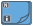

<!-- Generated by tools/export_studio_help.py; edit the reviewed source metadata, then regenerate. -->
# For Loop

[Structures functions](index.md) · [All functions](../index.md)

Places a resizable counted loop. N receives and exposes the I32 count; the movable i terminal exposes the current I32 iteration inside the body diagram.

## Product execution profiles

The shared index declares native examples for this object; see [the examples below](for_loop.md#examples) and [document profiles and evidence boundaries](../../reference/studio-draft-examples.md). Older binding/help statements retained below can lag those product profiles. They do not establish or deny the separately measured native profiles. An example declaration alone is not an execution result or admission of every overload.

Résumé français de l’aide Studio

**Boucle For**

Texte historique de l’aide conservé ci-dessous. Des exemples natifs distincts sont déclarés pour cet objet ; consultez les profils et preuves datés, sans déduire une compatibilité universelle de ce texte.

Place une boucle comptee redimensionnable. N recoit et expose le compte I32 ; le terminal i mobile expose l'iteration I32 courante dans le diagramme encapsule. [Types] N entier ; itération i entière ; tunnels transportant T ou indexant Array&lt;T&gt; vers T. Studio: Les terminaux dynamiques des structures sont gérés par le modèle de structure, et non par ce résolveur de fonction.

## Studio authoring profile

Contract status: **partial**. The connector below describes Studio authoring; execution availability is stated separately.

Retained binding and help description

This is the source declaration, not the current measured product-execution assessment.

Integer N; iteration integer i; tunnels transport T or index Array&lt;T&gt; into T. Studio: Dynamic structure terminals are managed by the structure model, not this function resolver.

## IN — inputs

| Displayed terminal / internal ID | Accepted / resolved type | Studio connection | Unwired input default | Meaning |
| --- | --- | --- | --- | --- |
| count `count` | `T:integer` | Required | Not specified | — |

A default is shown only for an input with an explicitly documented value. Preview/default *types* do not imply unwired operand values. If helper and binding flags differ, both are labelled.

## OUT — outputs

| Displayed terminal / internal ID | Accepted / resolved type | Studio connection | Unwired input default | Meaning |
| --- | --- | --- | --- | --- |
| count value `count_value` | `i64` | Required | — | — |
| iteration `iteration` | `i64` | Required | — | — |

A default is shown only for an input with an explicitly documented value. Preview/default *types* do not imply unwired operand values. If helper and binding flags differ, both are labelled.

## Types and connection rules

Historical Studio binding profile; no additional public FROG semantics are claimed.

- Type resolution: `fixed`; result expression: `i64;i64`.
- Implicit coercion: permitted by this profile.
- Arrays: not established; lifting policy: `none`.

Only the declared port expressions and connection policies are defined by this Studio profile; general array semantics remain unspecified.

**Input count:** 1; this contract does not enable variadic inputs.

## Execution and limits

**Public FROG / target Runtime:** not declared available by this authoring contract.

Scope: `requires_explicit_target_capability`.

Provider identity is retained from Studio. Executability must be established by the active target; it is not inferred from catalog visibility.

Retained authoring-contract limitations

These declarations belong to the binding snapshot. Compare them with the separately admitted native profiles and dated measurements linked above; they are not a current denial of those product profiles.

**Authoring/target contract limits:**

- The complete public execution semantics and target support for this legacy Studio profile have not been established.

Connector type defaults and persistence aliases

| Direction | ID | Preview/default type | Connection policy | Cardinality | Legacy port IDs |
| --- | --- | --- | --- | --- | --- |
| INPUT | `count` | `i64` | `numeric_implicit` | `single` | — |
| OUTPUT | `count_value` | `i64` | `exact` | `single` | — |
| OUTPUT | `iteration` | `i64` | `exact` | `single` | — |

## Examples

These are real `.frog` documents from the same index used by Studio. Backend names and expected results describe the examples; they are not execution certificates.

- [Notifier History : revenir à A sans relire son ancien signal](../../examples/sync.notifier.history_a_b_a.md) — Notifier History : revenir à A sans relire son ancien signal (`execution`, `studio-draft`).
- [First Call? : le premier passage, pas chaque itération](../../examples/sync.first_call.iterations.md) — First Call? : le premier passage, pas chaque itération (`execution`, `studio-draft`).
- [For : un registre initialisé accumule quatre incréments](../../examples/structure.for.initialized_shift_register.md) — For : un registre initialisé accumule quatre incréments (`execution`, `studio-draft`).
- [For : zéro itération conserve l'initialisation](../../examples/structure.for.zero_iterations.md) — For : zéro itération conserve l'initialisation (`execution`, `studio-draft`).
- [For : l'entrée auto-indexée limite N](../../examples/structure.for.indexed_input_limits_count.md) — For : l'entrée auto-indexée limite N (`execution`, `studio-draft`).
- [For : collecter les trois éléments par auto-indexation](../../examples/structure.for.indexed_output.md) — For : collecter les trois éléments par auto-indexation (`execution`, `studio-draft`).

## Identity and references

- Catalogue ID: `structures.for_loop`.
- Profile: `frog.studio.legacy.structures.for_loop.v1`.
- Definition: `frog.studio.structures.for_loop`.
- [NI API reference](https://www.ni.com/docs/en-US/bundle/labview-nxg-nodes-api-ref/page/for-loop.html).

NI links are reference sources for the connector model; Studio support is limited to the profile above. [Reference provenance and notation](../index.md#provenance-and-notation).
