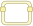

<!-- Generated by tools/export_studio_help.py; edit the reviewed source metadata, then regenerate. -->
# In Place Element Structure

[Structures functions](index.md) · [All functions](../index.md)

Access and replace data using paired border nodes. Right-click the border to add a pair; drag a node to move both sides or stretch its bottom edge to expose more elements.

## Product execution profiles

The shared index declares native examples for this object; see [the examples below](in_place_element_structure.md#examples) and [document profiles and evidence boundaries](../../reference/studio-draft-examples.md). Older binding/help statements retained below can lag those product profiles. They do not establish or deny the separately measured native profiles. An example declaration alone is not an execution result or admission of every overload.

Résumé français de l’aide Studio

**Structure Élément en place**

Texte historique de l’aide conservé ci-dessous. Des exemples natifs distincts sont déclarés pour cet objet ; consultez les profils et preuves datés, sans déduire une compatibilité universelle de ce texte.

Accédez aux données et replacez-les à l’aide de bornes appariées. Clic droit sur la bordure pour ajouter une paire ; déplacez une borne pour déplacer ses deux côtés ou étirez son bord inférieur pour exposer davantage d’éléments. [Types] Un seul sous-diagramme, sans sélecteur ni itérateur. Les paires accès/remplacement conservent types et rangs. Tableau, cluster, composantes de waveform, variant et accès générique sont gérés par l’éditeur. Runtime, Map et DVR indisponibles.

## Studio authoring profile

Contract status: **blocked**. The connector below describes Studio authoring; execution availability is stated separately.

Retained binding and help description

This is the source declaration, not the current measured product-execution assessment.

Studio-private single-body In Place structure with stable access/replacement pairs and exact type preservation. Runtime execution and storage optimization are unavailable.

One body, no selector or iterator. Paired access/replacement nodes preserve source types and array ranks. Array, Cluster, waveform components, Variant and generic access are editor-managed. Runtime, Map and DVR are unavailable.

## IN — inputs

No fixed inputs are declared in this binding profile. The editor or selected instance owns any contextual terminals.

## OUT — outputs

No fixed outputs are declared in this binding profile. The editor or selected instance owns any contextual terminals.

## Types and connection rules

Historical Studio binding profile; no additional public FROG semantics are claimed.

- Type resolution: `fixed`; result expression: `undecided`.
- Implicit coercion: not enabled by this resolver; individual port policies remain explicit.
- Arrays: not established; lifting policy: `none`.

Only the declared port expressions and connection policies are defined by this Studio profile; general array semantics remain unspecified.

Input count is instance-dependent or not established by this contract.

## Execution and limits

**Public FROG / target Runtime:** not declared available by this authoring contract.

Scope: `requires_explicit_target_capability`.

Provider identity is retained from Studio. Executability must be established by the active target; it is not inferred from catalog visibility.

Retained authoring-contract limitations

These declarations belong to the binding snapshot. Compare them with the separately admitted native profiles and dated measurements linked above; they are not a current denial of those product profiles.

**Authoring/target contract limits:**

- Runtime access/replacement lowering, alias analysis and storage optimization are not implemented.
- Map and DVR types and their synchronization contracts are not enabled.

Connector type defaults and persistence aliases

| Direction | ID | Preview/default type | Connection policy | Cardinality | Legacy port IDs |
| --- | --- | --- | --- | --- | --- |

## Examples

These are real `.frog` documents from the same index used by Studio. Backend names and expected results describe the examples; they are not execution certificates.

- [In Place : modifier une donnée par la paire entrée/sortie](../../examples/structure.ipe.generic_modify.md) — In Place : modifier une donnée par la paire entrée/sortie (`execution`, `studio-draft`).
- [In Place : indexer et remplacer un élément du tableau](../../examples/structure.ipe.array_index_replace.md) — In Place : indexer et remplacer un élément du tableau (`execution`, `studio-draft`).

## Identity and references

- Catalogue ID: `structures.in_place_element_structure`.
- Profile: `frog.studio.in_place.authoring.v1`.
- Definition: `frog.studio.structures.in_place_element_structure`.
- [NI API reference](https://www.ni.com/docs/en-US/bundle/labview-api-ref/page/structures/in-place-element-structure.html).

NI links are reference sources for the connector model; Studio support is limited to the profile above. [Reference provenance and notation](../index.md#provenance-and-notation).
