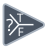

<!-- Generated by tools/export_studio_help.py; edit the reviewed source metadata, then regenerate. -->
# Select

[Structures functions](index.md) · [All functions](../index.md)

Places the Select structure glyph on the Diagram.

Résumé français de l’aide Studio

**Selectionner**

Place le glyphe Selectionner sur le diagramme. [Types] Sélecteur booléen/cluster d'erreur et deux valeurs compatibles de tout type : résultat du type commun des branches. Rang, schéma du cluster et identité de l'enum sont conservés ; les feuilles numériques peuvent être promues.

## Studio authoring profile

Contract status: **partial**. The connector below describes Studio authoring; execution availability is stated separately.

Boolean/error-cluster selector and two compatible values of any type yield the common branch type. Array rank, cluster schema and enum identity are preserved; numeric leaves may promote.

Boolean/error-cluster selector and two compatible values of any type yield the common branch type. Array rank, cluster schema and enum identity are preserved; numeric leaves may promote.

## IN — inputs

| Displayed terminal / internal ID | Accepted / resolved type | Studio connection | Unwired input default | Meaning |
| --- | --- | --- | --- | --- |
| t `true` | `T:any` | Required | Not specified | — |
| s `select` | `T:any` | Required | Not specified | — |
| f `false` | `T:any` | Required | Not specified | — |

A default is shown only for an input with an explicitly documented value. Preview/default *types* do not imply unwired operand values. If helper and binding flags differ, both are labelled.

## OUT — outputs

| Displayed terminal / internal ID | Accepted / resolved type | Studio connection | Unwired input default | Meaning |
| --- | --- | --- | --- | --- |
| s ? t : f `result` | `T:any` | Required | — | — |

A default is shown only for an input with an explicitly documented value. Preview/default *types* do not imply unwired operand values. If helper and binding flags differ, both are labelled.

## Types and connection rules

Boolean/error-cluster selector and two compatible values of any type yield the common branch type. Array rank, cluster schema and enum identity are preserved; numeric leaves may promote.

- Type resolution: `custom_resolver`; result expression: `resolve:frog.studio.polymorphic.type-resolution@1`.
- Implicit coercion: not enabled by this resolver; individual port policies remain explicit.
- Arrays: accepted; lifting policy: `none`.

**Input count:** 3; this contract does not enable variadic inputs.

## Execution and limits

**Public FROG / target Runtime:** not declared available by this authoring contract.

Scope: `requires_explicit_target_capability`.

Provider identity is retained from Studio. Executability must be established by the active target; it is not inferred from catalog visibility.

**Authoring/target contract limits:**

- NI reference verified for authoring types; this does not establish runtime support on the active target.

**Private Studio Run/Highlight:** the local function evaluator dispatches this catalogue identity. Inputs and output types must be resolved; unsupported value operations or representations fail explicitly. This local dispatch is separate from the public target Runtime declaration above.

Connector type defaults and persistence aliases

| Direction | ID | Preview/default type | Connection policy | Cardinality | Legacy port IDs |
| --- | --- | --- | --- | --- | --- |
| INPUT | `true` | `f64` | `any_explicit` | `single` | — |
| INPUT | `select` | `bool` | `any_explicit` | `single` | — |
| INPUT | `false` | `f64` | `any_explicit` | `single` | — |
| OUTPUT | `result` | `f64` | `exact` | `single` | — |

## Identity and references

- Catalogue ID: `structures.select`.
- Profile: `frog.studio.polymorphic.structures.select.v1`.
- Definition: `frog.studio.structures.select`.
- [NI API reference](https://www.ni.com/docs/en-US/bundle/labview-api-ref/page/functions/select.html).

NI links are reference sources for the connector model; Studio support is limited to the profile above. [Reference provenance and notation](../index.md#provenance-and-notation).
