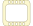

<!-- Generated by tools/export_studio_help.py; edit the reviewed source metadata, then regenerate. -->
# Flat Sequence Structure

[Structures functions](index.md) · [All functions](../index.md)

Places ordered frames side by side. Add, duplicate, reorder or resize a frame from its border. Wires may carry data to later frames, never to earlier frames.

## Product execution profiles

The shared index declares native examples for this object; see [the examples below](sequence_structure.md#examples) and [document profiles and evidence boundaries](../../reference/studio-draft-examples.md). Older binding/help statements retained below can lag those product profiles. They do not establish or deny the separately measured native profiles. An example declaration alone is not an execution result or admission of every overload.

Résumé français de l’aide Studio

**Structure Séquence plate**

Texte historique de l’aide conservé ci-dessous. Des exemples natifs distincts sont déclarés pour cet objet ; consultez les profils et preuves datés, sans déduire une compatibilité universelle de ce texte.

Place des cadres ordonnés côte à côte. Ajoutez, dupliquez, réordonnez ou redimensionnez un cadre depuis sa bordure. Les fils transmettent des données vers les cadres suivants, jamais vers les précédents. [Types] Sans sélecteur ni itérateur ; tunnels typés sans indexation, avec un seul producteur par sortie. Studio : édition et sauvegarde uniquement ; l’exécution séquentielle n’est pas implémentée. Séquence empilée et variables locales de séquence non activées.

## Studio authoring profile

Contract status: **blocked**. The connector below describes Studio authoring; execution availability is stated separately.

Retained binding and help description

This is the source declaration, not the current measured product-execution assessment.

Studio authoring for a flat Sequence: ordered stable frames, forward data dependencies and single-producer boundary tunnels. Execution is not implemented.

No selector or iteration terminal; typed non-indexing tunnels preserve data types, with one producer per output. Studio: authoring and document persistence only; sequential execution is not implemented. Stacked Sequence and Sequence Locals are not enabled.

## IN — inputs

No fixed inputs are declared in this binding profile. The editor or selected instance owns any contextual terminals.

## OUT — outputs

No fixed outputs are declared in this binding profile. The editor or selected instance owns any contextual terminals.

## Types and connection rules

Historical Studio binding profile; no additional public FROG semantics are claimed.

- Type resolution: `fixed`; result expression: `undecided`.
- Implicit coercion: not enabled by this resolver; individual port policies remain explicit.
- Arrays: not established; lifting policy: `none`.

Only the declared port expressions and connection policies are defined by this Studio profile; general array semantics remain unspecified.

Input count is instance-dependent or not established by this contract.

## Execution and limits

**Public FROG / target Runtime:** not declared available by this authoring contract.

Scope: `requires_explicit_target_capability`.

Provider identity is retained from Studio. Executability must be established by the active target; it is not inferred from catalog visibility.

Retained authoring-contract limitations

These declarations belong to the binding snapshot. Compare them with the separately admitted native profiles and dated measurements linked above; they are not a current denial of those product profiles.

**Authoring/target contract limits:**

- Flat-sequence runtime lowering, frame-completion barriers and output publication are not implemented.
- Stacked Sequence and Sequence Locals are not enabled by this authoring profile.

Connector type defaults and persistence aliases

| Direction | ID | Preview/default type | Connection policy | Cardinality | Legacy port IDs |
| --- | --- | --- | --- | --- | --- |

## Examples

These are real `.frog` documents from the same index used by Studio. Backend names and expected results describe the examples; they are not execution certificates.

- [Flat Sequence : entrée et passages entre trois frames](../../examples/structure.sequence.three_frames.md) — Flat Sequence : entrée et passages entre trois frames (`execution`, `studio-draft`).
- [Flat Sequence : traverser trois frames et une frame vide](../../examples/structure.sequence.native.flat_passages.md) — Flat Sequence : traverser trois frames et une frame vide (`execution`, `studio-draft`).
- [Flat Sequence : publier une frame terminée avant une attente](../../examples/structure.sequence.native.flat_wait_abort.md) — Flat Sequence : publier une frame terminée avant une attente (`expected-abort`, `studio-draft`).
- [Stacked Sequence : conserver et exécuter toutes les frames](../../examples/structure.sequence.native.stacked_passages.md) — Stacked Sequence : conserver et exécuter toutes les frames (`execution`, `studio-draft`).
- [Stacked Sequence : ne pas publier avant la dernière frame](../../examples/structure.sequence.native.stacked_wait_abort.md) — Stacked Sequence : ne pas publier avant la dernière frame (`expected-abort`, `studio-draft`).
- [Flat Sequence : une sortie précoce alimente une entrée tardive](../../examples/structure.sequence.native.flat_late_input.md) — Flat Sequence : une sortie précoce alimente une entrée tardive (`execution`, `studio-draft`).
- [Stacked Sequence : diagnostiquer une dépendance circulaire](../../examples/structure.sequence.native.stacked_late_cycle.md) — Stacked Sequence : diagnostiquer une dépendance circulaire (`expected-diagnostic`, `studio-draft`).

## Identity and references

- Catalogue ID: `structures.sequence_structure`.
- Profile: `frog.studio.sequence.flat.authoring.v1`.
- Definition: `frog.studio.structures.sequence_structure`.
- [NI API reference](https://www.ni.com/docs/en-US/bundle/labview-api-ref/page/structures/flat-sequence.html).

NI links are reference sources for the connector model; Studio support is limited to the profile above. [Reference provenance and notation](../index.md#provenance-and-notation).
