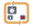

<!-- Generated by tools/export_studio_help.py; edit the reviewed source metadata, then regenerate. -->
# Timed Loop

[Structures functions](index.md) · [All functions](../index.md)

Places a resizable While-style loop with orange scheduling surfaces for initial timing, iteration feedback, next-iteration updates, and completion results.

Résumé français de l’aide Studio

**Boucle cadencee**

Place une boucle de type While redimensionnable avec des surfaces orange pour la configuration temporelle, le retour d'iteration, la mise a jour suivante et le resultat final. [Types] Entrées de temporisation/configuration et bornes de boucle/condition ; tunnels selon leur mode. Studio : contrat de bornes appelables pas encore implémenté. Studio: Aucun contrat de fonction statique appelable n’est actuellement déclaré dans Studio.

## Studio authoring profile

Contract status: **blocked**. The connector below describes Studio authoring; execution availability is stated separately.

Timing/configuration inputs and loop data/condition terminals; data tunnels preserve their configured mode. Studio: callable connector contract not yet implemented. Studio: No callable static function contract is currently declared in Studio.

## IN — inputs

No fixed inputs are declared in this binding profile. The editor or selected instance owns any contextual terminals.

## OUT — outputs

No fixed outputs are declared in this binding profile. The editor or selected instance owns any contextual terminals.

## Types and connection rules

Historical Studio binding profile; no additional public FROG semantics are claimed.

- Type resolution: `fixed`; result expression: `undecided`.
- Implicit coercion: not enabled by this resolver; individual port policies remain explicit.
- Arrays: not established; lifting policy: `none`.

Only the declared port expressions and connection policies are defined by this Studio profile; general array semantics remain unspecified.

Input count is instance-dependent or not established by this contract.

## Execution and limits

**Public FROG / target Runtime:** not declared available by this authoring contract.

Scope: `requires_explicit_target_capability`.

Provider identity is retained from Studio. Executability must be established by the active target; it is not inferred from catalog visibility.

**Authoring/target contract limits:**

- The complete public execution semantics and target support for this legacy Studio profile have not been established.

Connector type defaults and persistence aliases

| Direction | ID | Preview/default type | Connection policy | Cardinality | Legacy port IDs |
| --- | --- | --- | --- | --- | --- |

## Identity and references

- Catalogue ID: `structures.timed_loop`.
- Profile: `frog.studio.legacy.structures.timed_loop.v1`.
- Definition: `frog.studio.structures.timed_loop`.
- [NI API reference](https://www.ni.com/docs/en-US/bundle/labview-nxg-nodes-api-ref/page/timed-loop.html).

NI links are reference sources for the connector model; Studio support is limited to the profile above. [Reference provenance and notation](../index.md#provenance-and-notation).
