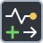

<!-- Generated by tools/export_studio_help.py; edit the reviewed source metadata, then regenerate. -->
# Generate Occurrence

[Synchronization functions](../index.md) · [All functions](../../index.md)

Returns this node instance's occurrence reference. Repeated activations within the same executable instance reuse that reference. Distinct nodes and isolated instances remain independent. No payload or native address is editable.

## Product execution profiles

The shared index declares native examples for this object; see [the examples below](generate.md#examples) and [document profiles and evidence boundaries](../../../reference/studio-draft-examples.md). Older binding/help statements retained below can lag those product profiles. They do not establish or deny the separately measured native profiles. An example declaration alone is not an execution result or admission of every overload.

Résumé français de l’aide Studio

**Generate Occurrence**

Texte historique de l’aide conservé ci-dessous. Des exemples natifs distincts sont déclarés pour cet objet ; consultez les profils et preuves datés, sans déduire une compatibilité universelle de ce texte.

Retourne la référence d'occurrence propre à ce nœud et à son instance exécutée. Les activations répétées réutilisent cette référence ; les nœuds et instances isolés restent indépendants. Aucun message ni adresse native n'est éditable.

## Studio authoring profile

Contract status: **partial**. The connector below describes Studio authoring; execution availability is stated separately.

Retained binding and help description

This is the source declaration, not the current measured product-execution assessment.

Returns the occurrence belonging to this node and executable instance. Repeated activations reuse the same reference within the execution context; distinct Generate nodes and isolated instances remain distinct. Generate is stateful and must not be merged or moved out of its instance.

## IN — inputs

No fixed inputs are declared in this binding profile. No connector is invented here.

## OUT — outputs

| Displayed terminal / internal ID | Accepted / resolved type | Studio connection | Unwired input default | Meaning |
| --- | --- | --- | --- | --- |
| occurrence `occurrence` | `ref<frog.sync.occurrence>` | Recommended | — | — |

A default is shown only for an input with an explicitly documented value. Preview/default *types* do not imply unwired operand values. If helper and binding flags differ, both are labelled.

## Types and connection rules

Fixed nominal Occurrence reference without payload. Queue, Notifier, Semaphore, Rendezvous, widget references and scalar data do not coerce to Occurrence.

- Type resolution: `fixed`; result expression: `declared_output_type`.
- Implicit coercion: not enabled by this resolver; individual port policies remain explicit.
- Arrays: not accepted; lifting policy: `none`.

No implicit array lifting or payload parameter. Explicit reference transport preserves identity without creating a resource.

**Input count:** 0; this contract does not enable variadic inputs.

## Execution and limits

**Public FROG / target Runtime:** declared available within the scope below.

Scope: `requires_explicit_target_capability`.

Implementation: `frog.studio.synchronization.occurrences.generate`.

Requires the existing execution-context state and cooperative wait services plus supported lowering. This local Studio profile is not a published NI refnum ABI or a claim about unverified targets.

Retained authoring-contract limitations

These declarations belong to the binding snapshot. Compare them with the separately admitted native profiles and dated measurements linked above; they are not a current denial of those product profiles.

**Authoring/target contract limits:**

- Local FROG session, timeout-domain and per-Wait observation policies are explicit; unverified targets require a declared capability and execution evidence.

Connector type defaults and persistence aliases

| Direction | ID | Preview/default type | Connection policy | Cardinality | Legacy port IDs |
| --- | --- | --- | --- | --- | --- |
| OUTPUT | `occurrence` | `ref<frog.sync.occurrence>` | `exact` | `single` | — |

## Examples

These are real `.frog` documents from the same index used by Studio. Backend names and expected results describe the examples; they are not execution certificates.

- [Occurrence : un signal réveille trois attentes](../../../examples/sync.occurrence.broadcast.md) — Occurrence : un signal réveille trois attentes (`execution`, `studio-draft`).
- [Occurrence : deux nœuds Generate distincts](../../../examples/sync.occurrence.distinct_nodes.md) — Occurrence : deux nœuds Generate distincts (`execution`, `studio-draft`).
- [Occurrence : timeout zéro sans signal](../../../examples/sync.occurrence.poll_no_signal.md) — Occurrence : timeout zéro sans signal (`execution`, `studio-draft`).
- [Occurrence : arrêter une attente infinie](../../../examples/sync.occurrence.infinite_stop.md) — Occurrence : arrêter une attente infinie (`expected-abort`, `studio-draft`).
- [Flat Sequence : publier une frame terminée avant une attente](../../../examples/structure.sequence.native.flat_wait_abort.md) — Flat Sequence : publier une frame terminée avant une attente (`expected-abort`, `studio-draft`).
- [Stacked Sequence : ne pas publier avant la dernière frame](../../../examples/structure.sequence.native.stacked_wait_abort.md) — Stacked Sequence : ne pas publier avant la dernière frame (`expected-abort`, `studio-draft`).

## Identity and references

- Catalogue ID: `synchronization.occurrences.generate`.
- Parent palette: [Occurrences](../occurrences.md).
- Profile: `frog.studio.palette.synchronization.occurrences.generate.v1`.
- Definition: `frog.studio.synchronization.occurrences.generate`.
- [NI API reference](https://www.ni.com/docs/en-US/bundle/labview-api-ref/page/functions/generate-occurrence.html).

NI links are reference sources for the connector model; Studio support is limited to the profile above. [Reference provenance and notation](../../index.md#provenance-and-notation).
