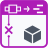

<!-- Generated by tools/export_studio_help.py; edit the reviewed source metadata, then regenerate. -->
# Disconnect G Types

[Variant functions](../index.md) · [All functions](../../index.md)

Data Type Analysis palette entry. Artwork is available; ports and execution are not defined yet.

Résumé français de l’aide Studio

**Déconnecter les types G**

Entree de la palette d'analyse de type de donnees. Visuel disponible ; ports et execution pas encore definis. [Types] Entrées : Variant, erreur. Sorties : variant de sortie:Variant ; erreur. Métadonnées de types, pas conversion de valeur vers le type inspecté. Studio : contrat de bornes appelables pas encore implémenté.

## Studio authoring profile

Contract status: **blocked**. The connector below describes Studio authoring; execution availability is stated separately.

Supplied Data Type Analysis palette artwork for Disconnect G Types. Ports and execution are not defined by this visual integration.

Inputs: Variant, error. Outputs: variant out:Variant; error. These describe contained types, not a value converted into the inspected type. Studio: callable connector contract not yet implemented.

## IN — inputs

No fixed inputs are declared in this binding profile. No connector is invented here.

## OUT — outputs

No fixed outputs are declared in this binding profile. No connector is invented here.

## Types and connection rules

undecided

- Type resolution: `undecided`; result expression: `undecided`.
- Implicit coercion: not enabled by this resolver; individual port policies remain explicit.
- Arrays: not established; lifting policy: `undecided`.

none

Input count is instance-dependent or not established by this contract.

not_variadic

## Execution and limits

**Public FROG / target Runtime:** not declared available by this authoring contract.

**Authoring/target contract limits:**

- Port identities and cardinality are not defined.
- Accepted overloads and result type rules are not defined.
- Runtime behavior and provider are unavailable.

Connector type defaults and persistence aliases

| Direction | ID | Preview/default type | Connection policy | Cardinality | Legacy port IDs |
| --- | --- | --- | --- | --- | --- |

## Identity and references

- Catalogue ID: `variant.data_type_analysis.disconnect_g_types`.
- Parent palette: [Data Type Analysis](../data_type_analysis.md).
- Profile: `variant.data_type_analysis.disconnect_g_types.catalog-only.blocked`.
- Definition: `frog.studio.variant.data_type_analysis.disconnect_g_types`.
- [NI API reference](https://www.ni.com/docs/en-US/bundle/labview-nxg-nodes-api-ref/page/disconnect-g-types.html).

NI links are reference sources for the connector model; Studio support is limited to the profile above. [Reference provenance and notation](../../index.md#provenance-and-notation).
