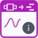

<!-- Generated by tools/export_studio_help.py; edit the reviewed source metadata, then regenerate. -->
# Get Waveform Information

[Variant functions](../index.md) · [All functions](../../index.md)

Typed Data Type Analysis connector. Inputs: variant: variant; error in: cluster&lt;status:bool,code:i32,source:string&gt;. Outputs: Y array type: variant; error out: cluster&lt;status:bool,code:i32,source:string&gt;. Metadata describes the contained type, not a conversion of the payload. Native execution requires the declared Variant Analysis v2 target capability and stays within its admitted type profile.

## Product execution profiles

The shared index declares native examples for this object; see [the examples below](get_waveform_info.md#examples) and [document profiles and evidence boundaries](../../../reference/studio-draft-examples.md). Older binding/help statements retained below can lag those product profiles. They do not establish or deny the separately measured native profiles. An example declaration alone is not an execution result or admission of every overload.

Résumé français de l’aide Studio

**Obtenir des infos sur une waveform**

Texte historique de l’aide conservé ci-dessous. Des exemples natifs distincts sont déclarés pour cet objet ; consultez les profils et preuves datés, sans déduire une compatibilité universelle de ce texte.

Connecteur typé d’analyse de données. Entrées : variant : variant ; error in : cluster&lt;status:bool,code:i32,source:string&gt;. Sorties : Y array type : variant ; error out : cluster&lt;status:bool,code:i32,source:string&gt;. Ces métadonnées décrivent le type contenu, sans convertir sa valeur. L’exécution native exige la capacité cible déclarée Variant Analysis v2 et reste limitée à son profil de types admis.

## Studio authoring profile

Contract status: **partial**. The connector below describes Studio authoring; execution availability is stated separately.

Retained binding and help description

This is the source declaration, not the current measured product-execution assessment.

Typed authoring connector for get waveform info. Port identities, metadata schemas and 4815 connector positions follow the supplied LabVIEW reference. Native execution is unavailable until an explicit provider implements this operation.

## IN — inputs

| Displayed terminal / internal ID | Accepted / resolved type | Studio connection | Unwired input default | Meaning |
| --- | --- | --- | --- | --- |
| variant `variant` | `variant` | Required | Not specified | — |
| error in `error_in` | `cluster<status:bool,code:i32,source:string>` | Optional | Not specified | — |

A default is shown only for an input with an explicitly documented value. Preview/default *types* do not imply unwired operand values. If helper and binding flags differ, both are labelled.

## OUT — outputs

| Displayed terminal / internal ID | Accepted / resolved type | Studio connection | Unwired input default | Meaning |
| --- | --- | --- | --- | --- |
| Y array type `y_array_type` | `variant` | Required | — | — |
| error out `error_out` | `cluster<status:bool,code:i32,source:string>` | Required | — | — |

A default is shown only for an input with an explicitly documented value. Preview/default *types* do not imply unwired operand values. If helper and binding flags differ, both are labelled.

## Types and connection rules

Fixed metadata types from the NI LabVIEW 2020 connector contract shown in the supplied video. Variant payload types are inspected, not converted or propagated as output value types. No runtime provider is declared.

- Type resolution: `fixed`; result expression: `variant`.
- Implicit coercion: not enabled by this resolver; individual port policies remain explicit.
- Arrays: not accepted; lifting policy: `none`.

One Variant envelope, including an aggregate payload; no elementwise lifting of Array&lt;Variant&gt;. Metadata array outputs have their declared schemas.

**Input count:** 2; this contract does not enable variadic inputs.

## Execution and limits

**Public FROG / target Runtime:** not declared available by this authoring contract.

Scope: `requires_explicit_target_capability`.

Implementation: `frog.studio.variant.data_type_analysis.get_waveform_info.v1`.

Required provider: `frog.studio.variant.type-analysis@2`.

Candidate native type-analysis@2; current native receipts and actual UI Run qualification are separate. Exact immutable Source descriptors are authoritative; no Runtime parsing of Source JSON. Type witnesses hold intrinsic defaults, not payload data.

Retained authoring-contract limitations

These declarations belong to the binding snapshot. Compare them with the separately admitted native profiles and dated measurements linked above; they are not a current denial of those product profiles.

**Authoring/target contract limits:**

- Current UI Run qualification pending; source changes are not delivery. NI binary/type-definition/provider ABI compatibility is not implied.

Connector type defaults and persistence aliases

| Direction | ID | Preview/default type | Connection policy | Cardinality | Legacy port IDs |
| --- | --- | --- | --- | --- | --- |
| INPUT | `variant` | `variant` | `exact` | `single` | — |
| INPUT | `error_in` | `cluster<status:bool,code:i32,source:string>` | `exact` | `single` | — |
| OUTPUT | `y_array_type` | `variant` | `exact` | `single` | — |
| OUTPUT | `error_out` | `cluster<status:bool,code:i32,source:string>` | `exact` | `single` | — |

## Examples

These are real `.frog` documents from the same index used by Studio. Backend names and expected results describe the examples; they are not execution certificates.

- [Examiner le type des échantillons d’une acquisition](../../../examples/variant.data_type_analysis.get_waveform_info.worked.md) — Examiner la donnée typée et son diagnostic. (`execution`, `studio-draft`).

## Identity and references

- Catalogue ID: `variant.data_type_analysis.get_waveform_info`.
- Parent palette: [Data Type Analysis](../data_type_analysis.md).
- Profile: `frog.studio.palette.variant.data_type_analysis.get_waveform_info.v1`.
- Definition: `frog.studio.variant.data_type_analysis.get_waveform_info`.
- [NI API reference](https://www.ni.com/docs/en-US/bundle/labview-nxg-nodes-api-ref/page/get-waveform-info.html).
- [NI API reference](https://www.ni.com/docs/en-US/bundle/labview-api-ref/page/menus/categories/programming/cluster/datatypeparsing-mnu.html).

NI links are reference sources for the connector model; Studio support is limited to the profile above. [Reference provenance and notation](../../index.md#provenance-and-notation).
