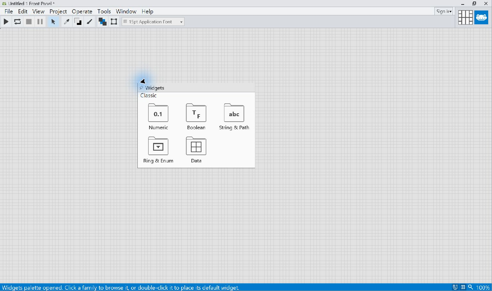

# Getting started

Create a small document, place a control, add a Diagram operation, and save your
work. You can inspect each step in the coordinated Source view.

## 1. Meet the three views

Launch Graiphic Studio. The **Front Panel** is the design surface for controls,
indicators, labels, and images. The **Block Diagram** holds typed terminals,
functions, structures, and wires. **Source** shows the live saved representation.

| Shortcut | Result |
| --- | --- |
| `Ctrl+E` | Raise the companion Front Panel or Block Diagram |
| `Ctrl+Shift+E` | Open or raise Source |
| `Ctrl+T` | Tile the Front Panel and Block Diagram |
| `Ctrl+H` | Show or hide Context Help |

Each view has its own window. Switching views preserves the current window's
position and size. See [Window workflow](interface/window-workflow.md).

## 2. Place a Numeric control

1. Right-click an empty part of the Front Panel to open the **Widget Navigator**.
2. Single-click **Numeric** to browse the family.
3. Choose **Numeric Control**, then click the Front Panel to place it.
4. Edit its value and give its separate label a useful name.

A Control supplies values to the graph. An Indicator displays results. The
control's typed terminal appears in the Block Diagram automatically.

A double-click on a family chooses its default widget directly. During
placement, the preview follows the pointer; `Escape` cancels it.

*Existing capture of the Navigator workflow. The current family catalog may
contain additional entries.*

## 3. Move, resize, and label

Drag the widget's body or frame to move it. Resize using the available handles;
some compact or automatically fitted objects have different resize rules.

| Gesture | Result |
| --- | --- |
| Hold `Shift` while moving | Constrain movement to an axis |
| Hold `Ctrl` through a drag | Move a duplicate |
| Hold `Shift` while resizing | Preserve proportions where supported |
| Double-click empty Front Panel space | Create a free label |

For a Front Panel label, `Enter` commits and `Shift+Enter` adds a line.
Committing an empty label removes it. Widget labels can be positioned separately
and reconnect to their magnetic default anchor when moved back nearby.

## 4. Add a function

1. Press `Ctrl+E` to raise the Block Diagram.
2. Right-click empty Diagram space to open the **Function Navigator**.
3. Open **Programming > Numeric** and choose **Add**.
4. Click the canvas to place the preview, or drag the tile onto the canvas.

Hover the operation to reveal its ports. Connect compatible ports to build the
dataflow. Use [Context Help](interface/context-help.md) to inspect terminal
requirements and types, and the [Functions reference](functions/index.md) for
the operation's detailed contract.

Placement, local simulation, and target execution have separate support limits.
Studio reports unsupported operations for the selected path.

## 5. Save and inspect

Choose **File > Save** (`Ctrl+S`) and save a `.frog` document. Use **Save As**
(`Ctrl+Shift+S`) to keep a separate copy. Recent Files records successful opens
and saves.

Press `Ctrl+Shift+E` to inspect Source after making an edit. You will see the
explicit widgets, values, layout, bindings, nodes, and connections. Studio's
authoring draft and public FROG source have different envelopes; see
[the document model](reference/document-model.md) before exchanging source
with another tool.

## 6. Try the supported local execution path

For a graph admitted by Studio's private simulation, **Run** can start with
Highlight off. Highlight displays the same session's execution; toggling it
does not start another run. Supported controls stay interactive and indicators
are read-only. **Stop** returns to normal editing.

Read [Run and Highlight](interface/run-and-highlight.md) before relying on this
path. The public native execution corridor and general target runtime support
remain distinct from local simulation.

## Continue

- [Widgets](widgets/index.md): choose the right input, display, or container.
- [Block Diagram](interface/block-diagram.md): terminals, wires, structures, and context actions.
- [Functions](functions/index.md): find an operation and read its ports and limits.
- [Studio Options](interface/options.md): theme, language, text, navigation, and assistance.
- [Keyboard shortcuts](reference/keyboard-shortcuts.md): keep common actions close.
