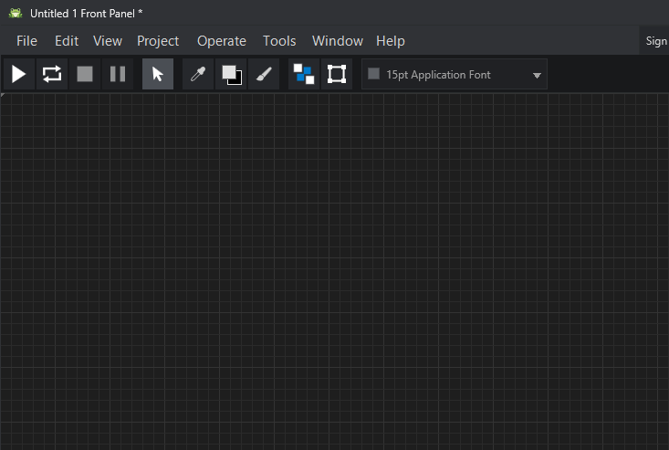

# Graiphic Studio documentation

The [26 October documentation reconciliation](reference/documentation-refresh-2026-10-26.md) brings forward Run/Highlight, standalone Build, standard Type Def, Tabs and attached-comment guides. The example results below remain a dated measurement.

Build an interface, connect a dataflow, and inspect one `.frog` document from
three coordinated views. Start with a short walkthrough or open the reference
for the object you are using.

## Start here

| Your next task | Guide |
| --- | --- |
| Create your first document | [Getting started](getting-started.md) |
| Move between the three windows | [Window workflow](interface/window-workflow.md) |
| Design an interface | [Front Panel](interface/front-panel.md) and [Widgets](widgets/index.md) |
| Place and connect operations | [Block Diagram](interface/block-diagram.md) and [Function Navigator](interface/function-navigator.md) |
| Understand a function or wire | [Context Help](interface/context-help.md) and [Functions reference](functions/index.md) |
| Try a supported graph | [Run and Highlight](interface/run-and-highlight.md) |
| Compile a standalone application | [Build](interface/build.md) |
| Share a type across documents | [Type Definitions](interface/type-definitions.md) |
| Create pages of independent controls | [Tab Controls](widgets/tab-controls.md) |
| Link an annotation to an object | [Attached comments](interface/attached-comments.md) |
| Open a real .frog with an explanation and expected outputs | [Examples](examples/index.md) |

*Existing documentation capture: the Front Panel layout. Recent features and
menus are described in the guides below; this image is not a new release capture.*

## Design and edit

Use the [Widget Navigator](interface/widget-navigator.md) to place controls and
indicators. Organize them with the [Selection Pane](interface/selection-pane.md),
[Arrange and Resize](interface/arrange-and-resize.md), and
[Color Tools](interface/color-tools.md). Combine values in an
[Array](widgets/array-container.md) or [Cluster](widgets/cluster.md).

Define public input and output slots in the [Interface Map](interface/interface-map.md),
customize the document icon in the [Icon Editor](interface/icon-editor.md), and
choose local preferences in [Studio Options](interface/options.md).

## Find a function

The [Functions reference](functions/index.md) follows the existing Studio helper:
function names, icons, terminal requirements, declared types, and explicit limits.
Browse a family or use documentation search with the function name or catalog ID.

| Data and operations | Organization and services |
| --- | --- |
| [Numeric](functions/numeric/index.md) · [Boolean](functions/boolean/index.md) · [Comparison](functions/comparison/index.md) | [Structures](functions/structures/index.md) · [Cluster](functions/cluster/index.md) |
| [String](functions/string/index.md) · [Path](functions/path/index.md) · [Array](functions/array/index.md) | [Application Control](functions/applicationcontrol/index.md) · [Connectivity](functions/connectivity/index.md) |
| [Timestamp](functions/timestamp/index.md) · [Variant](functions/variant/index.md) · [Mathematics](functions/mathematics/index.md) | [Error](functions/error/index.md) · [File](functions/file/index.md) · [Synchronization](functions/synchronization/index.md) |

## Understand the document

Inspect the saved representation in [Source](interface/source-view.md). The
[document model](reference/document-model.md) explains ownership and formats;
[custom bindings](reference/custom-bindings.md) explain saved interface layouts.
Keep [keyboard shortcuts](reference/keyboard-shortcuts.md) and the
[glossary](reference/glossary.md) nearby while learning.

## Current support

The [25 October 2026 checkpoint](reference/development-checkpoint.md) records
**625 real example documents and 1,219 successful file/backend checks**.
Studio authoring, local runtime profiles and public FROG Source retain separate
scopes. Read the measured capabilities and limits when choosing an execution
path. A visible catalogue entry is not a promise that every target or overload
is supported, and this checkpoint is not a complete application qualification.
