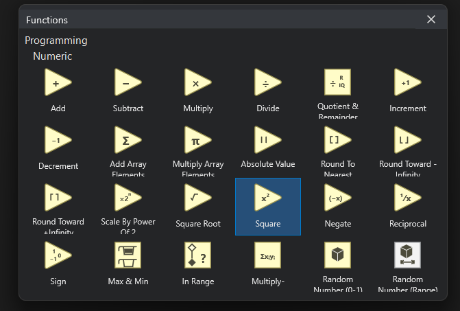

# Function Navigator

Find a Diagram operation by family, inspect its help, and place it on the
canvas. For its exact terminals and types, open the [Functions reference](../functions/index.md).

*Existing Numeric-family capture. The reference includes the expanded current
catalog and identifies each operation's support limits.*

## Open and browse

Open the Block Diagram and use its Function Navigator toolbar button,
**View > Function Navigator**, or right-click empty Diagram space.
Single-click a family to browse it; double-click a family to choose its default
operation where one is defined.

The hierarchy includes data operations, structures, containers, references,
connectivity, files, and synchronization. Some folders are reserved and contain
no functions yet. The [family index](../functions/index.md) lists the documented
catalog without requiring you to know its internal identifier.

## Place an operation

1. Choose an operation tile. A translucent preview follows the pointer.
2. Move to the Diagram and click to place it.
3. Or hold a tile, drag it onto the Diagram, and release there.
4. Press `Escape`, or release a drag outside the Diagram, to cancel.

A successful placement creates an authored Diagram object and marks the document
modified. Placement does not execute the function. Unsupported catalog entries
report their current limitation instead of producing an executable substitute.

## Read the help before wiring

Open [Context Help](context-help.md) with `Ctrl+H` and hover a tile or a placed
function. It shows the operation, its terminal requirements, and declared or
resolved types where available. Lock the help with `Ctrl+Shift+L` to keep it
visible while reading **Detailed help**.

The operation icon remains the same in the Navigator, help, placement preview,
and Diagram. Theme changes affect the surrounding interface rather than the
function artwork. An icon's color alone does not define its type or execution.

## Keep useful families open

An unpinned Navigator closes when you click elsewhere, press `Escape`, or begin
another command. Pin it to keep an independent tool window. Several pinned
Navigators can remain open.

Resize a pinned window to reflow its tiles; scrollbars appear when needed.
Pinned Function Navigators belong to the Diagram workspace: they hide when the
Front Panel receives focus and return when the Diagram is raised.

## Understand support

A function may be available for **authoring**, admitted by **private Studio
Run/Highlight**, or implemented by a **public FROG target**. These capabilities
are separate. Some editor-managed objects and private functions do not have a
published public primitive contract.

Examples include the private Queue service and limited reference/Connectivity
workflows. Generic Property/Invoke graph execution is still unavailable.
Consult the operation's page and [current capabilities](../reference/development-checkpoint.md)
before choosing an execution path.

## Related guides

[Block Diagram](block-diagram.md) · [Functions](../functions/index.md) ·
[Run and Highlight](run-and-highlight.md)
