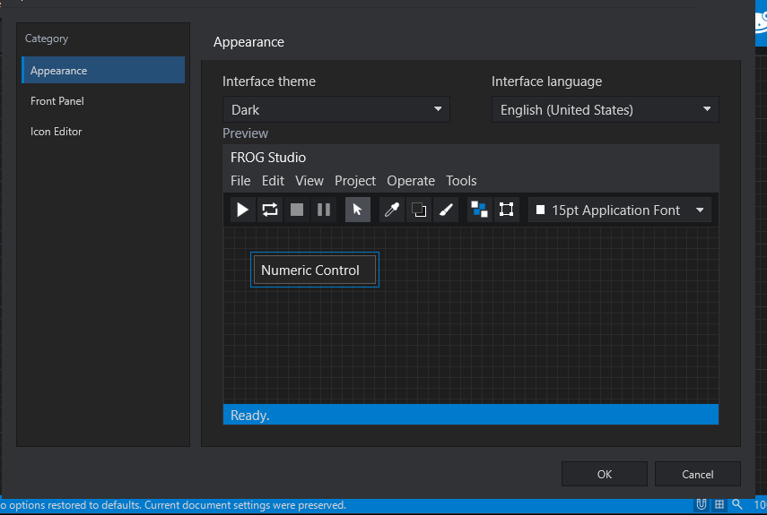

# Studio Options

Open **Tools > Options...** to adjust the editor. The seven categories separate
appearance, document-view defaults, drawing behavior, and assistance.

| Category | What you can configure |
| --- | --- |
| Appearance | Light/Dark theme, interface language, navigation size, version visibility, default document text size |
| Front Panel | Grid visibility, pitch, snapping, style, default background and zoom |
| Diagram | Default background and supported starting zoom |
| Icon Editor | Canvas background, collections, and reusable SVG glyph folders |
| Assistance | Interactive helper behavior |
| User Experience | Tool selection after drawing |
| Selection Auras | Selection outline thickness for the listed element families |

**Apply** saves changes and keeps Options open. **OK** saves and closes it.
**Cancel** discards changes made since the last Apply.

*Existing Appearance capture. Its category list predates the current seven-page
Options window; use the category table above for the current layout.*

## Theme, language, and navigation

Choose **Light** or **Dark** and inspect the live preview before applying.
Interface languages are English (United States), French, Italian, Chinese
(Simplified), Japanese, German, and Spanish.

Navigation sizing offers **Small** (9 pt), **Medium** (11 pt), and **Large**
(13 pt). It scales Navigator tiles, palette labels, spacing, and shell controls.
An already placed Front Panel widget keeps its authored dimensions.

Pinned Navigators retain a manually chosen window size where possible and
reflow their scaled tiles. Transient Navigators adapt their window size to the
chosen level and available monitor area.

**Show Studio version** controls whether the version appears in the main window.

## Default document text size

The Appearance page has a separate **Default document text size** control.
Use minus and plus to change it in points. This setting concerns Front Panel
and Block Diagram text; it is separate from navigation sizing. Explicit custom
text sizes are preserved.

Text fitting depends on the object. For example, scalar Numeric Diagram
constants and Enum values fit their text automatically; manually resizable
String/Path fields and container viewports have their own rules. See
[Numeric](../widgets/numeric.md), [Ring and Enum](../widgets/ring-and-enum.md),
and [String and Path](../widgets/string-and-path.md).

## Front Panel and Diagram defaults

For the Front Panel, configure **Show front panel grid**, **Default grid size**,
**Enable grid alignment**, and **Grid draw style** (Lines, Dots, or Graph Paper).
Grid visibility and snapping are independent.

The Front Panel and Diagram pages also provide default background colors and
starting zoom. Diagram zoom remains within its supported **60%–150%** range.
Changing a view preference does not change a value or a function's meaning.
Applying an unrelated Options category preserves the current document's
existing grid and view settings.

## Icon Editor

**Use theme background** follows the active theme. Disable it to choose a custom
solid canvas background. The background is a preview aid and does not fill
transparent artwork.

Use the collections and glyph-folder list to organize reusable SVGs:

- **Add Folder...** adds a library location.
- Double-click a path to edit it; `Enter` commits and `Escape` cancels.
- **Remove** forgets the selected folder without deleting its files.

Applying Options refreshes an open Icon Editor's library. See
[Icon Editor](icon-editor.md) for artwork editing.

## Assistance

**Interactive helper** enables delayed explanations on interactive controls.
When [Context Help](context-help.md) is open with `Ctrl+H`, those explanations
are shown in the help window instead of separate floating hints.

## User Experience

**FROG Style** returns a drawing tool to selection after use. **Manual** keeps
the chosen tool active until you select another tool or press `Escape`.

## Selection Auras

Adjust the outline thickness for the element families listed on this page.
Hover a numeric control to read which elements that family covers. These
settings affect the editor's selection feedback; function SVG artwork remains
the same in Light and Dark mode.

## Preferences and document properties

Local preferences are restored in later Studio sessions. The reset icon opens
the reset workflow for Studio settings. Read its confirmation before applying.

Document values, widget styles, explicit layout, and public bindings belong to
the `.frog` document. Choose per-document Array storage in
[FROG Properties > Storage](frog-properties.md).
