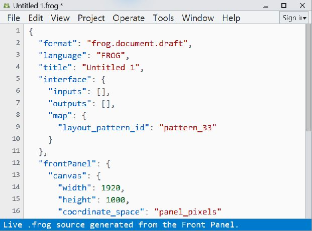

# Source view

Source displays the live `.frog` representation of the current document. Use it
to inspect what the Front Panel and Block Diagram edits have produced.

*Existing capture of live source inspection; it does not establish conformance
or execution of every format the Studio can read.*

## Open and inspect

Press `Ctrl+Shift+E` to open or raise Source. Its window has independent geometry
and does not resize the other views. Line numbers and syntax highlighting help
you inspect identities, values, bindings, Diagram nodes and edges, artwork,
authored layout, and saved view state.

Edits in the visual workspace are reflected in the current session's source
projection. Selection, hover, menus, and temporary runtime inputs are not
executable document data.

## Recognize the envelope

Studio Readable authoring uses `frog.document.draft`, revision 2, and
`frontPanel`. Automatic/Compact numeric storage opts into private revision 3.
Public FROG source uses `spec_version` and the published optional `front_panel`
section. The `.frog` extension alone does not identify the envelope.

Studio's public-source reader and preservation/transaction writer are separate
from the full editing-model importer. A file can be preserved without every
construct being projected onto the canvas, validated, lowered, or executable.
See [the document model](../reference/document-model.md).

## Check execution separately

A successful save is not a target-runtime qualification. Private Studio
Run/Highlight and the narrow public execution paths have their own admission
rules. Read [current capabilities](../reference/development-checkpoint.md) and
[Run and Highlight](run-and-highlight.md) when choosing an execution path.
