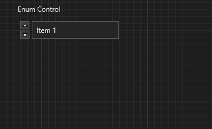
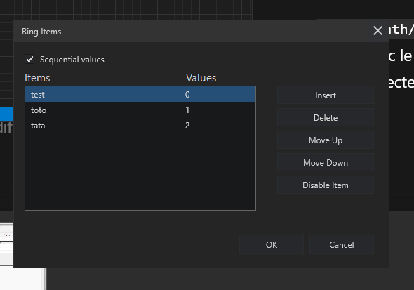

# Ring And Enum Widgets

Ring and Enum are list-style value widgets and share one Widget Navigator
family. Each has Control and Indicator variants.

## Ring

Ring presents item text backed by numeric values. The default item is `Item 1`.
Click the value area of a Ring Control to open its item list. Ring Indicator
shows the current item without accepting selection.

Use **Edit Items...** in the context menu to manage the source list. The editor
supports direct double-click editing, Insert, Delete, Move Up, Move Down,
Disable Item, and sequential or explicit values. Insert creates a row and starts
editing it immediately.

## Picture Ring

Use **Edit Images** to open the **Images** section of Properties. Add several
images, replace a selected image, or use **Move Up** and **Move Down** to change
the order. The first image has index `0`. A control sends the selected index to
the diagram; an indicator displays the image at the index it receives.

Click the image to choose a thumbnail. **Visible Items → Dropdown Arrow** hides
the arrow and gives its space back to the image. The picture keeps its intrinsic
size when you resize the box. Shrink the box to clip the picture, then enlarge
it to reveal the rest. The frame can shrink to 24 × 24 logical units. The
catalogue and resources travel with the document or linked definition.
[Using Picture Rings in Type Definitions](../interface/type-definitions.md).

## Enum

Enum presents a finite named set with permanent automatic Size to Text and the
same increment/decrement layout as Ring. Enum values use integer storage, while the
displayed item text remains user-facing.

Click the center of an Enum Control to open its popup list. Drag the surrounding
body or frame to move the widget. The popup marks the current item and updates
the control when another enabled item is chosen.

## Increment And Decrement

The increment/decrement pair can be shown or hidden and positioned on the left
or right. Its rules match Numeric: the pair is linked, compact, and optional.

## Resize And Label

Ring can resize horizontally. Enum fits the selected item automatically,
growing or shrinking after item, font, size or style changes. Measurement includes
the dropdown arrow and a small margin; manual resize and a Size to Text command
are unnecessary. The value area stays interactive and the surrounding body is
available for moving. Labels use the same magnetic default anchor as other core
widgets. Array viewport dimensions remain a separate setting.

## Binding

Ring binds as a numeric value. Enum also carries its domain and complete ordered
definition, including enumerator names and numeric values; integer storage alone
does not make two Enum definitions compatible. The current implementation diagnoses
different definitions rather than silently treating them as the same numeric type.
Control variants bind toward public inputs; indicators bind from public outputs.
See the [development checkpoint](../reference/development-checkpoint.md) for
current qualification and source/runtime limits.

## Create a typed peer

Enum and Ring menus provide one **Create Constant / Create Control / Create
Indicator** trio. These commands create a separate typed object, preserving the
original and its item configuration. They are separate from **Change to
Control / Indicator**, which changes the existing object's role.

Enum creation retains the complete ordered definition and representation.
Explicit nested field/cell targets are resolved separately from the enclosing
container. The Array's menu creates an Array rather than silently selecting a
scalar child.

The latest menu changes are compiled in the 15 October checkpoint; their new
regression cases have not yet executed. See
[current capabilities](../reference/development-checkpoint.md).
